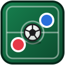
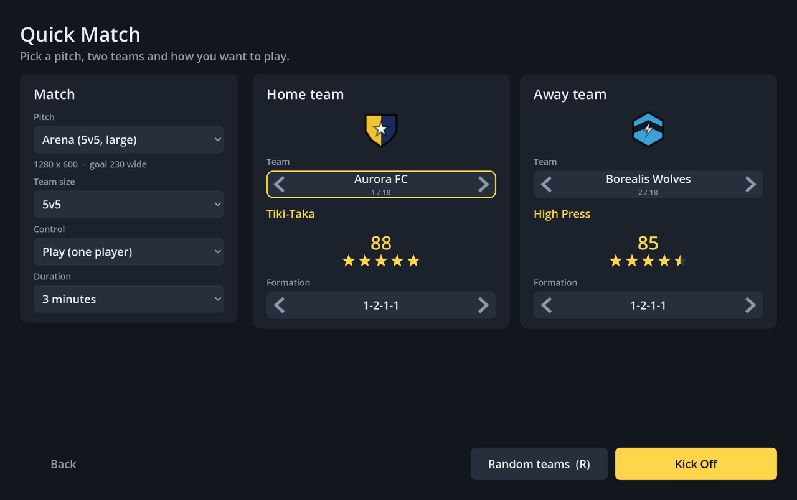
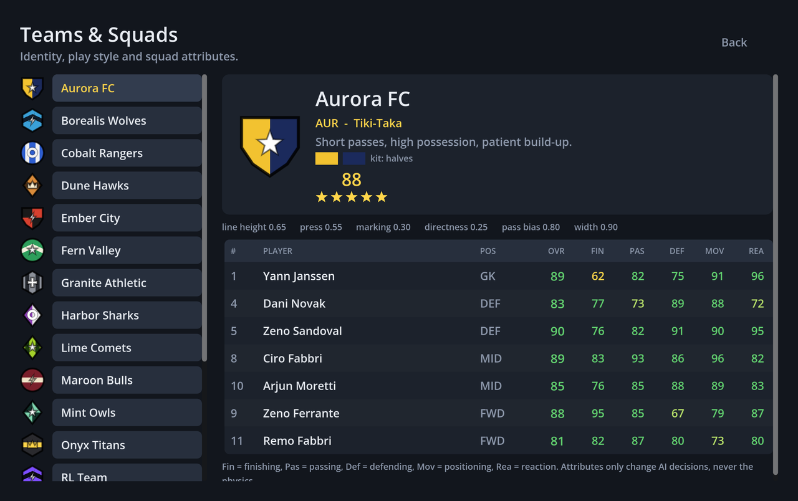
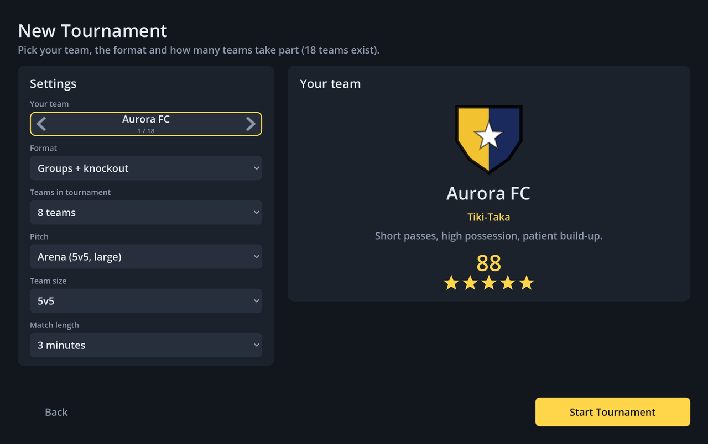
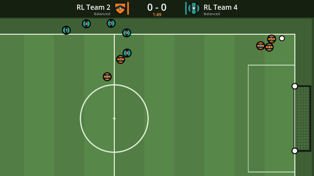

  

# Simple Soccer

A Haxball-style football game for Godot 4.6 built for AI experiments: custom 60 Hz Haxball physics, data-driven pitches/teams/styles, rule-based AI, per-player stats and grades, and tournaments.

Run the project and the main menu opens (`res://scenes/main.tscn`).

## Screenshots

| | |
|---|---|
|  **Main menu** |  **Quick match setup**: pitch, size, teams, formations, control |
|  **Kickoff**: the camera zooms in before the whistle |  **Live match**: RL Team vs Aurora FC, 5v5 on the arena pitch |
|  **Teams & squads**: logos, kits, rosters, styles, star ratings |  **Tournament setup**: league, knockout or groups + knockout |

*Match report: score, scorers, team stats and a 3.0-10.0 grade for every player.*

**UI work: follow `DESIGN.md`** (tokens, components, screen layouts, rollout plan).

## Match gallery

Goals from different pitches, sizes and teams (all AI vs AI, recorded with `tools/capture_gifs.gd`):

| | |
|---|---|
|  **Classic 3v3**: Owls vs Ember |  **Futsal 2v2**: Harbor Sharks vs Dune Hawks |
|  **Big pitch 4v4**: Arrows vs Bulls |  **Big with pillars 5v5**: Rose vs Tide |

## Controls
Arrows/WASD move, X/Space kick, Q switch player (Team mode), T sim speed, Esc/P pause, M quit match, Enter continue after the final whistle.

## Team strength & kickoff
There are no difficulty levels. A bot is exactly as good as its player's attributes (`SimPlayer.quality`: reaction -> perception delay, finishing/passing -> aim error, positioning -> position noise, defending -> marking, passing/positioning/reaction -> decision speed), identically for allies and opponents. Strong teams are teams with strong players (16 teams span ~55 to ~84 base rating, 4 per tier, see `tools/generate_data.py`). Kickoffs use a random taker, direction and short delay (seeded by the match seed).

## Modes
- Quick match: pitch, size (3v3 / 5v5), teams, duration, control (none / one player / whole team).
- Two leagues: the **Rule Based League** (16 fictional teams driven by the handmade AI styles) and the **Reinforcement Learning League** (the RL Teams, driven by trained nets). In Quick Match each side picks a league first, then a team from it (sides can be in different leagues).
- Teams browser: teams grouped by league, with logos, kits, rosters, play styles and a tier (Elite / Strong / Average / Weak).
- Tournament: pick a league, then league, knockout, or groups + knockout among its teams (saved to `user://tournament.json`). Knockout and groups need 4, 8 or 16 teams; other counts play a round robin. Knockout draws: golden goal, then penalties.
- Report after each match: score, scorers, team stats, player grades (3.0-10.0), man of the match.

## Architecture
- `scripts/core/` headless deterministic sim (MatchSim, Disc, SimPlayer, SimBatch for threaded batches)
- `scripts/data/` PlayerDef, TeamDef, StyleDef, Formations, Database (autoload)
- `brain/` the AI, in Python: team brain, rule bots, neural-net teams, the server Godot talks to (see below)
- `scripts/stats/` match stats and Rating.grade
- `scripts/tournament/`, `scripts/view/`, `scripts/ui/`
- `data/{pitches,styles,teams}/*.json`, regenerated by `tools/generate_data.py` (seeded; style tuning lives there)

### Bot quality and team AI (how a team gets strong or weak)
- Per player (`brain/match.py` `Player`): reaction -> perception delay, finishing/passing -> aim error, positioning -> position noise, defending -> marking tightness and lane cover, vision (passing+positioning+reaction) -> decision speed, how clean a pass lane must be, and shot-lane choice.
- Ball carrier (`brain/rules.py` `StyleBot._decide_action`): shoots at the goal-mouth point whose line is furthest from every opponent (keeper included), takes longer shots when the lane is open, dribbles by scoring 7 headings against opponents' positions and momentum, and rates passes by receiver space plus whether an opponent can reach the lane before the ball (`_pass_margin`, ball travel time from the real kick speed and damping).
- Ball physics is fixed (a kick adds exactly 5 px/tick to the ball's current velocity, damping 0.99/tick), so the bots predict the ball: `intercept` (`brain/rules.py`) finds the earliest point on the ball's path a player can reach (chasers run to it, and an off-ball *interceptor* is sent onto an opponent's pass/shot, `style.intercept`); `_compensated_dir` corrects the kick direction for the ball's velocity so passes/shots on a moving ball go where intended.
- Game management (`TeamBrain.urgency`): in the last ~45 % of the match a team that is behind pushes up, shoots earlier and presses with one more player; a team that is ahead drops deeper.
- Team strength comes from `tools/generate_data.py` (`base`). The UI shows the team rating (average of the best 5 players) as a number with 0-5 stars (`TeamDef.stars`). Teams are picked with `<` / `>` pickers (Left / Right keys) instead of dropdowns.

Physics is identical for every team. Attributes (finishing, passing, defending, positioning, reaction) and styles only change AI behaviour.

## Adding content
- Pitch: `data/pitches/<id>.json` (copy `classic.json`).
- Style: `data/styles/<id>.json` (line_height, compactness, width, press, marking, directness, shoot_range, pass_bias, risk, keeper_sweep, forward_stay, support_dist, fluidity, attack_commit). `fluidity` 0 = fixed goalkeeper, 1 = whoever is rearmost keeps goal; `attack_commit` = how many players join the attack. Strategy params: `intercept` (run onto the ball path of opponent passes/shots), `counter_press` (extra chasers right after losing the ball), `long_shot` (shoot from range when the lane is open), `switch_play` (prefer passes to the far side). 16 styles ship: balanced, tiki_taka, high_press, park_the_bus, counter_attack, long_ball, wing_play, total_football, catenaccio, all_out_attack, gegenpress, sharpshooters, man_to_man, zone_trap, dribblers, switch_play.
- Team: `data/teams/<id>.json` (also loaded from `user://teams`). Optional `"league"`: `"rules"` or `"rl"`; without it a team with an `ml_model` joins the RL league, every other team the rule-based one.
- Formation: `scripts/data/formations.gd`, slots `[role, fx, fy]`.
- New `class_name` scripts need an editor rescan before `run_project` sees them.

## The AI runs in Python (`brain/`)
Godot runs the physics, the match rules, the stats and the drawing. Every decision a bot takes, for rule-based teams and
neural-net teams alike, is made by the brain server `brain/server.py` (Python 3 with numpy):
- `brain/rules.py`: `TeamBrain` (who chases, who keeps goal, marking, interceptions, game management) and `StyleBot` (one player).
- `brain/nets.py`: the observations a net sees (`features_team`, 46 numbers; `features`, the older 49 / 54), net loading and sampling.
- `brain/protocol.py`: the wire format. `scripts/core/brain_link.gd` is the Godot side: one connection per match; each AI tick
  it sends a snapshot of the match and gets back every due bot's move, kick and kick type, plus who keeps goal.
- The game starts the server itself when nothing listens on port 7330 (interpreter: `$SOCCER_PYTHON`, else the first
  `python3` that has numpy; log in `user://brain_server.log`). It exits after 10 idle minutes, or as soon as a file in
  `brain/` changes (the next match starts the new code). Each match gets its own forked process, so parallel matches use all cores.
- A net plays a team through `MatchConfig.nets[team]` (`{"model": path}` or `{"port": n}` for a running `tools/net_server.py`);
  a team with `ml_model` in its JSON gets its net automatically. RL training (`rl/rl_env.gd`) asks the brain for the
  observations too, so the observation code exists once.

The Python port was checked against the old GDScript bots on recorded matches (same states, same "random" numbers):
10,214 team-brain updates and 46,250 rule-bot decisions, and 12,422 net decisions, all identical.
`tools/bench_sim.tscn` measures speed (on a Mac: ~7,100 sim ticks/s for rule-vs-rule matches, ~3,000 training steps/s).

## Experiments
RL experiments run unattended on the Raspberry Pi through a queue (`exp/queue/`), a runner service and a web dashboard on port 8080: see [rl/README.md](rl/README.md#experiment-pipeline-rlexp_runnerpy-exp-toolsdashboardpy) and [docs/experiment_pipeline.md](docs/experiment_pipeline.md).

## Machine learning

*Two RL teams playing each other (RL Team 2 vs RL Team 4).*
The RL teams are trained with PPO in Python (`rl/`, see [rl/README.md](rl/README.md)) and played by the brain server.
The earlier GDScript experiments (imitation learning, DAgger and evolution strategies against the rule bots) are in the git
history before the move of the AI to Python.

**Live training viewer, Raspberry Pi notes:** see `rl/README.md` (`tools/watch_training.tscn` shows matches of the newest checkpoint with a training sidebar; `tools/net_server.py` serves the newest / best checkpoint and the dashboard's opponent; `--w_jitter` anti-twitch reward).

## Team control mode
`MatchConfig.ControlMode.TEAM`: Q switches to the teammate nearest the ball; `auto_switch` does it automatically (`MatchSim.set_controlled` / `switch_controlled`).

## Regenerating the screenshots
More goal clips (several teams, pitches and sizes): `xvfb-run -a Godot --path . --resolution 1280x720 res://tools/capture_gifs.tscn` (edit `SCENARIOS` in `tools/capture_gifs.gd`), then `python3 tools/make_gifs.py`.

With a window available (not `--headless`): `Godot --path . res://tools/capture_screenshots.tscn`. It plays a real RL Team match, saves the PNGs and dumps frames around goals to `docs/screenshots/clip*/`, then run `python3 tools/make_gifs.py` to shrink the PNGs and build the GIFs.

## Not included (by design)
Fatigue, fouls, offside, substitutions.

## Player grades

`scripts/stats/rating.gd` turns events into a 1-10 grade: 6.0 plus an "impact" summed from goals, shot quality
(xG), assists/key passes (xA), each pass (progress, pressure, where it was lost), dribbles and dispossessions,
tackles vs interceptions vs loose-ball recoveries, clearances, blocks, goalkeeping (save difficulty, goals
conceded vs xG) and clean sheets. Weights are per role *played* (whoever was in goal most of the match is graded
as GK). `ROLE_OFFSET` was calibrated with batches of simulated matches so every role averages about 6.4
(p10 about 5.1, p90 about 7.9). Raw counters live in `player_match_stats.gd`.

## Human control and keeper (AI notes)

- A human-controlled player is never picked as keeper, chaser or marker by the team brain; bots give him room
  (`StyleBot._avoid_human`) and do not send a second chaser at the ball when he is on it.
- The keeper reads the shot path and runs to the earliest point he can reach (slow acceleration is modelled),
  comes out to narrow the angle (`KEEP_*` in `brain/rules.py`), and only charges a loose ball when he wins the race to it.

## Goals and kickoffs

- After a goal the scorer's bot teammates run to him and huddle (the human-controlled player is never steered, he can move freely); the pause
  lasts 2.5-4.3 s depending on how far they have to run (`MatchSim.goal_pause`). The view adds rings and confetti.
- At kickoff the kicking team may use the whole centre circle, including the part on the opponents' side, so the
  ball can be played backwards. The other team stays out of the circle and in its own half.

- A goal only counts once the whole ball is over the goal line (centre beyond `half_w + ball.radius`).
- Goal frames are drawn in the kit colour that contrasts most with the pitch (brightened if still too close, with a
  dark outline), so a green team on a green pitch stays readable (`MatchView._goal_colour`).

## RL team (plays like the trained net)

*RL Team 4 (cooperation fine-tune) scoring against Cobalt.*

*RL Team 3 vs Aurora.*
League result of the shipped weights: 61 W, 3 D, 0 L in 64 full matches against the 16 rule-based teams (2.91 pts/match, 5.1 goals for and 1.1 against per match); details in `rl/results_league_final.txt`.
`data/teams/rl_team.json` ("RL Team") has `"ml_model": "res://data/models/rl_5v5_arena.json"`: all 5 players,
keeper included, are driven by a net trained with Python PPO (`rl/`, see `rl/README.md`). Pick it in Quick match /
Tournament like any other team, on the **5v5** size (the arena pitch is what it trained on). On other sizes the net
does not fit and the team falls back to its rule-based style. Any team can use a net the same way via `ml_model`.

`data/teams/rl_team_2.json` ("RL Team 2") uses `data/models/rl_5v5_arena_v2.json`: the same net after extra self-play / league training
(`rl/selfplay.py`) with human-likeness rewards (pass quality, spacing, kick discipline). "RL Team" keeps the original validated weights.

`data/teams/rl_team_3.json` ("RL Team 3") uses `data/models/rl_5v5_arena_v3.json`: the self-play snapshot at update 500 (league 2.97 pts/match,
0.27 goals against; kick discipline and spacing close to the rule bots, see `rl/results_selfplay.txt`).

`data/teams/rl_team_4.json` ("RL Team 4") uses `data/models/rl_5v5_arena_v4.json`: a cooperation fine-tune of RL Team 3 (individual pass credit,
key-pass / expected-assist rewards, "stand open" reward; snapshot at update 600). League 3.00 pts/match (64/64 wins), about 3x the key passes of
RL Team 3 (4.25 vs 1.38 per match); it concedes a bit more (0.48 goals/match) and its keeper roams further.

`data/teams/rl_team_5.json` ("RL Team 5") uses `data/models/rl_5v5_arena_v5.json`: cooperation fine-tune with anti-farming rewards (cooperation cap per match, keeper-stays-home penalty)
and 60% fully random starting layouts (`coop5`, update 1200). About 4.6 key passes per match like RL Team 4, but no reward farming and a keeper that stays closer to its goal (137 px).
