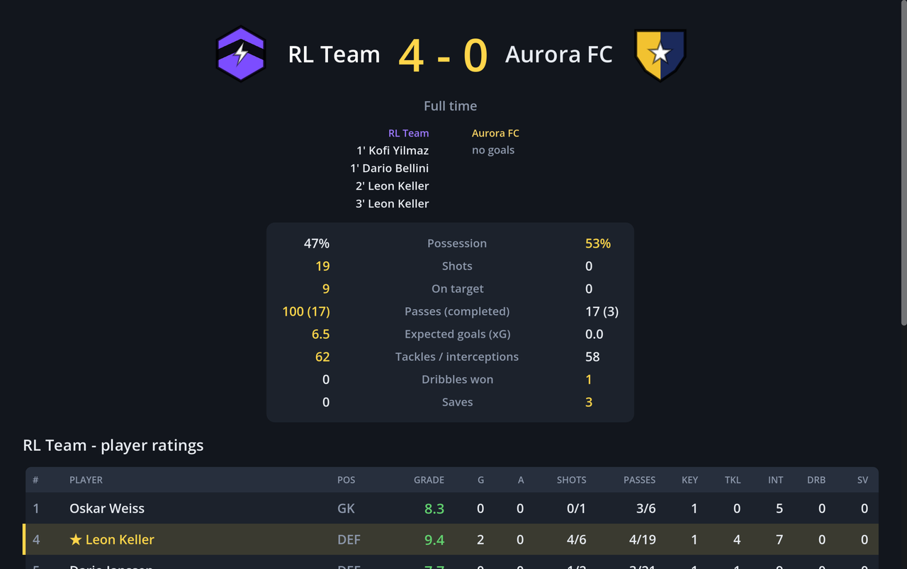
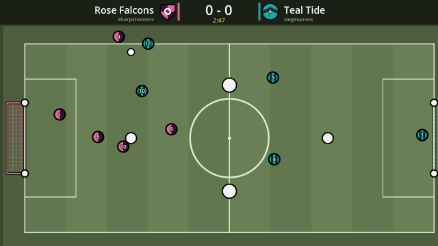
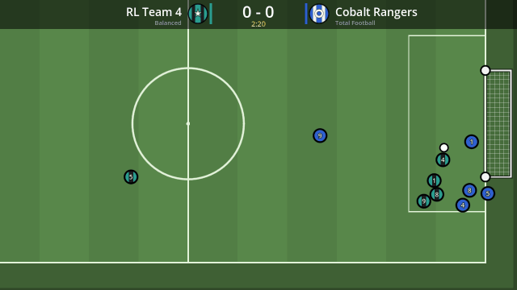

<p align="center">
  
</p>

# Simple Soccer

A Haxball-style football game in the browser, built for AI experiments: custom 60 Hz Haxball physics, data-driven pitches/teams/players, rule-based and reinforcement-learning AI, per-player stats and grades, and tournaments.

```bash
python3 -m venv .venv && .venv/bin/pip install -e '.[train]'     # once: the project as an installed package (numpy, torch)
source .venv/bin/activate                                         # every new terminal (or call .venv/bin/python directly)
python3 web/app.py
```

Then open <http://localhost:8080/#/game> (from another computer: `http://<this machine>:8080`). The same page has the **Lab** (the
experiment dashboard) next to the **Game**. Dependencies and packages are listed in `pyproject.toml` (numpy; torch for training,
`.[train]`); with the venv active every script runs as `python3 <dir>/<script>.py` from anywhere in the checkout, and the packages
(`soccer`, `rl`, `lab`, `elo`, ...) import from anywhere (`python -m elo`, `python -m rl.evaluate ...`). One machine runs
everything: [lab/SETUP.md](lab/SETUP.md).

## Screenshots

| | |
|---|---|
| <br>**Main menu** | <br>**Quick match setup**: pitch, size, teams, control |
| <br>**Kickoff**: the camera zooms in before the whistle | <br>**Live match**: RL Team vs Aurora FC, 5v5 on the arena pitch |
| <br>**Teams and players**: logos, kits, line-ups, archetypes | <br>**Tournament setup**: league, knockout or groups + knockout |


*Match report: score, scorers, team stats and a 3.0-10.0 grade for every player.*

**UI work: follow [docs/design.md](docs/design.md)** for the Game (tokens, components, screen layouts) and [docs/lab_design.md](docs/lab_design.md) for the Lab. The screenshots and GIFs were captured from the earlier Godot version of the game; the browser game draws the same screens.

## Match gallery

Goals from different pitches, sizes and teams (all AI vs AI):

| | |
|---|---|
| <br>**Classic 3v3**: Owls vs Ember | <br>**Futsal 2v2**: Harbor Sharks vs Dune Hawks |
| <br>**Big pitch 4v4**: Arrows vs Bulls | <br>**Big with pillars 5v5**: Rose vs Tide |

## Controls
Arrows/WASD move, X/Space kick, Q switch player (Team mode; a controller: left stick, A / X / RT kick, LB / RB switch, Start pause; more people: "Local multiplayer"), T sim speed (x1 / x2 / x4 / x8), Esc/P pause, M (while paused) quit the match, Enter continue after the final whistle. Main menu: Up / Down and Enter. On the team select (Quick match): Tab or a click picks the side, Left / Right its team, Up / Down its league, S swaps the teams, R random teams, Enter kicks off, Esc back to the menu. In the other menus: Left / Right change a focused picker, Enter starts, Esc goes back.

## Local multiplayer
Several people on one computer, each with their own device: the keyboard and every connected controller (Xbox or any "standard"
controller). With a controller connected, **Kick off** on the Quick match opens **Who plays where**: every device is a card that
moves to the home side, the middle (not playing) or the away side with its own Left / Right, and Up / Down picks what it controls
there: **Whole team** (switch with Q / LB / RB), **Any player** (the most advanced spot still free) or one player of the line-up.
- **Against each other** (one person per side): each may control the whole team or one player.
- **On the same side**: each controls **one player for the whole match**, never the same one, and nobody switches; the AI plays the
  rest of the team. The first person of a side takes its kickoffs.
- Nobody on a side: watch. One person: every device moves them, as without the picker. The places are remembered in the browser.
- In the match every device moves only its own person's player, marked with a translucent ring in that person's colour (P1 red,
  P2 blue; off screen: an arrow on the window edge with P1 / P2). Anyone can pause; the pause card says who plays what. A controller of the
  match that disconnects pauses it until it is back. Multiplayer matches are not recorded (the datasets have one player).
- Engine: `soccer/core/match.py` `Human` (one per person: side, mode, slot, controlled player, keys, Q ranking) and `check_humans` (the
  rules above); the setup's `"humans"` list (`game/api.py`), `"h"` on the inputs (`game/session.py`), `web/game/sides.js` (the
  picker), `web/game/pad.js` / `match.js` (one input per device). Tournaments and the Puzzle are one person.

## Players, teams and kickoff
A **player** (`data/players/<id>.json`, `soccer/players.py`) is a brain with a name: a rule-based **archetype** with its own
algorithm, settings and skill (0-100), or a trained net. Every player has the same body (speed, kick, size); the skill only sets
a rule-based player's own precision and reaction (`soccer/ai/skill.py`: perception delay, aim error, position noise, decision
speed). Every player **decides alone**: there is no team brain, and teammates talk only through their **calls** (`ball`,
`open`, `run`, `cover`; [docs/public_view.md](docs/public_view.md)). There are no positions, no keeper role and no tactics:
every team takes the same kickoff spots for a size, any player can stand on any spot, and whoever is deepest steps in to guard
the goal when nobody calls cover.

The ten archetypes (`soccer/ai/players/`, one file each, on the shared base `base.py` and toolkit `soccer/ai/kit.py`):

| Archetype | How it plays |
|---|---|
| Poacher | lives on the last defender's shoulder, calls `run`, shoots first time, barely defends |
| Playmaker | drops deep to receive (`open`), through balls to runners, rarely shoots; screens the defence |
| Dribbler | carries the ball past defenders on curving runs, shoots after beating a man |
| Ball winner | hunts the carrier (two on the ball if need be), lays it off at once to whoever calls `open` |
| Sweeper | the last man: calls `cover`, guards the goal, sweeps up behind the defence, clears long |
| Winger | owns a touchline, sprints forward (`run`), runs down the line and crosses low |
| Target man | holds the ball up front, lays it off to runners, turns and shoots when free |
| Presser | presses the carrier or stands in the lane to the next receiver |
| Box-to-box | supports and makes late runs into the box, sprints back when the ball is lost |
| Shadow | marks the most dangerous opponent goal-side and cuts out passes meant for that player |

`tests/test_players.py` checks that each one plays as it says (the sweeper is the deepest, the winger the widest, ...).
A **team** (`data/teams/<id>.json`, `soccer/teams.py`) is an identity (name, colours, kit, crest) and a
**line-up** of 5 players in order. A match of N per side fields the first N who can play that size; the same player may appear
several times and line-ups may be **mixed** (rule-based and net players together, `soccer/game/seating.py`). The Rule Based League
teams field five different rule-based players each. The current nets understand
only 5v5, so a team of nets only plays 5v5. Kickoffs use a random taker (any player), direction and short delay (seeded by the
match seed). A knockout draw goes to **golden-goal overtime** (no time limit, no penalties).

## What a player can see (fair information)
Every player decides from the same **public view** (`soccer/core/view.py`; the specification is [docs/public_view.md](docs/public_view.md)):
what a spectator could know, plus anything it computes from that (inferring, predicting, simulating, searching). Players are
anonymous: nobody knows who another player is or how good it is, only its own skill.

| In the view | Never in the view |
|---|---|
| the ball and every player as an anonymous body (team, slot, kickoff spot, position, velocity, size) | who a player is: name, kind, archetype, skill (except your own) |
| the last 32 ticks of all of it | the match engine and its objects |
| match clock, score, time left, overtime, state, the kickoff (whose, who takes it), the last touch | any other agent's inside, teammates included: plan, memory, random numbers, buttons |
| your teammates' calls (`ball`, `open`, `run`, `cover`) and which of them a person controls | the opponents' calls, the other team's kickoff timer |
| the pitch and the physics (public constants: anyone may simulate forward) | |

`tests/test_view.py` enforces the rule (imports, names, no agent reaches the match, a view or another agent, teammates
included; calls heard only by teammates; anonymous opponents). An agent is any object with `decide(view, me)` returning an
`Act` (buttons and a call, `soccer/core/act.py`); the spec shows a minimal one. (Opus 5.5 High, which planned on a clone of the whole match, was
removed for this reason: "Opus 5.5 High: removed".)

## Modes
- Quick match (the team select): two halves in the two teams' colours, each with its league, a crest carousel (the neighbouring teams of the league beside the picked one; click one to jump), a faint large crest behind, a You / AI badge (you always play the home side; the swap button or S swaps the teams), **Elo** at the chosen size (this
  machine's ratings, `elo/`, see "Rankings") and one sentence on **how the team plays**, measured, not designed: `game/profiles.py` plays
  every team 16 scouting matches and stores the statistics in `data/team_profiles.json`; `game/api.py` `describe` turns what sets a
  team apart from its league (with the ball; without it; how it scores) into the sentence. Re-run `python3 game/profiles.py` after
  adding teams or nets (nets that only exist in `out_5v5/ckpt/` are profiled on the machine that has them; until then they show "Play style not measured yet"). Every team takes the same kickoff spots for a size (no formations, no tactics). The bar underneath: players per side, minutes, control (one player /
  whole team / watch), recording; More: the pitch.
- **Dataset** ("Record my play", on by default, remembered in the browser): every match you play is saved as a training file for
  imitation learning (`data/human/`, see "Recording your play" below). A red REC mark shows in the corner while it records.
- Four leagues: **My Teams** (the teams you built, see below), the **Rule Based League** (16 fictional teams, each a line-up of five different rule-based archetypes), the **Reinforcement Learning League** (RL Team 1-5 and Net Lab, teams of net players) and the **Mixed League** (line-ups that mix rule-based and net players: All Stars, Academy XI, Iron Wall, High Flyers). Each side picks a league (a list, so more leagues fit), then a team from it; teams are ordered by Elo. A team that cannot play the chosen size (only 5v5 nets) is played at the largest size both teams can play.
- Teams: one league at a time (the league list at the top, or Left / Right), strongest first; the picked team in its colours with its Elo, how it plays and its line-up (each player's type, archetype, skill and the sizes it can play; a click opens the player). Enter starts a quick match with it; **Copy and edit** opens the builder with a copy (the teams of `data/teams` are never edited from the game), **Edit team** on your own teams.
- **Players** (`#/game/players`): every player, filtered by type (rule-based, net), by the size it can play and by name. A player's page: who it is, how it was made (for nets: run, line, old rating), its style as bars, the teams that field it, and "Build a team with ...".
- **Build a team** (`#/game/build`): five slots in order (click a slot, then a player; reorder with the arrows; 1-5 pick a slot), name, colours, kit and crest with a live preview. It shows which sizes the team can play and who takes the pitch at each. Saved teams go to the **My Teams** league and are kept on this machine only (`local/my_teams/`, ignored by git, `POST /api/game/team`); they play quick matches and tournaments like any other team, but are not part of the experiment ladder.
- **Rankings** (`#/game/rankings/<size>`): one page per team size, Players and Teams: Elo ± its 95% range, games, record, goals scored and conceded against the average opponent, a team's bonus over its players. The ratings are this machine's (below).
- Tournament: pick your team (Left / Right, R random), a league or **All leagues** (a mixed tournament of every team), then league, knockout, or groups + knockout among its teams (saved in the browser, so it continues where you left it). Only teams that can play the tournament's size take part. Knockout and groups need 4, 8 or 16 teams; other counts play a round robin. Knockout draws: golden-goal overtime.
- Report after each match: score, scorers, team stats, and each player's goals, assists, shots, passes, tackles, interceptions, dribbles and blocked shots.

## Ratings (run once after cloning)
Every player and team has an Elo **per team size** (1v1 to 5v5) from matches played on **this machine**; results live in
`local/elo.db` (git-ignored, never pushed). After cloning, build them once:

```bash
python3 -m elo init
```

About 10 minutes on a MacBook Air (30 games per entry and size; `--full`: 100 games, about 35 minutes). After that the web app
keeps refining them whenever the machine is idle. A team is rated as the average of its players on the pitch plus a small bonus;
the average rule-based player of a size is pinned at 1500. Details, commands and how to read the numbers: [docs/ratings.md](docs/ratings.md).

## Architecture
Four parts, each using the one below it:

```
web/      the web app: one server (app.py) and the page, with two areas: Game and Lab
game/     the game's back end: catalog, match setup, tournaments, live matches (the pages are web/game/)
lab/      experiments: queue, runner, Lab API, live demo match, agent CLI (the pages are web/lab/)
rl/       training and evaluation of the net teams (PPO, environment, league / head-to-head / scouting)
soccer/   the match core (Python): physics, rules, stats, grades, rule-based and net AI
data/     pitches, players, teams, kickoff spots per size, shipped nets (JSON)
elo/      the ratings: per-size Elo for players and teams, local database (python3 -m elo)
local/    this machine only, git-ignored: the ratings database, the teams you built
```

- `soccer/` (no UI): `data.py` (pitches, players, teams, kickoff spots, kit colours), `match.py` (the simulation,
  60 ticks/s), `stats.py`, `rating.py`, `rng.py` (Godot's random generator, bit for bit), `ai/` (`view.py` the public view every player decides from, `lineup.py` who drives each slot, `agent.py` what an agent answers (buttons and a call), `kit.py`
  the rule-based players' toolkit, `players/` the ten archetypes, `skill.py`, `nets.py` net players and observations).
- `game/`: `api.py` (catalog, a match setup -> `MatchConfig`, whole matches simulated on all cores), `tournament.py`
  (fixtures, standings, statistics), `session.py` (a live match over a WebSocket), `routes.py` (the HTTP API).
- `web/`: `app.py` (the server, standard library only: static files, `/api/game/...`, `/ws/match`, and the Lab's API from
  `lab/dashboard.py`), `ws.py` (a minimal WebSocket), `index.html` (the shell with the Game / Lab switch), `game.js` +
  `game/*.js` + `game.css` + `draw.js` (the game, ES modules: `game/core.js` state and helpers, one module per screen,
  `game/render.js` the match on the canvas; logos and kits in `draw.js`), `lab/*.js` + `style.css` (the Lab: plain scripts
  loaded in order, one per page, `lab/core.js` helpers and charts, `lab/app.js` routing and start-up).
- `rl/` ([rl/README.md](rl/README.md)): `env.py`, `client.py`, `agent.py`, `selfplay.py`, `distill.py`, `evaluate.py`,
  `eval_checkpoint.py`, `export_team.py`, `selfplay_args.py` (the training options, without torch).
- `lab/` ([lab/README.md](lab/README.md)): `exp_runner.py`, `tracker.py`, `lab.py`, `dashboard.py` (Lab API), `live.py`,
  `run.sh`, `health_log.py`, `thermal_guard.py`. Results and specs live in `exp/`, checkpoints in `out_5v5/`, logs in `logs/`.
- `tests/` regression tests of the core, training environment, evaluations, tournaments and the web app (see "Tests"); `tools/`
  `bench.py` (core speed), `team_bench.py` (one team against the league / RL teams / trained nets: points, goals, and how
  much it plays as a team), `generate_data.py` (regenerates the pitches); `docs/` notebook,
  rewards, pipeline design, UI design guide, old results.

### Rule-based players: what they share (how a player gets strong or weak)
- Skill (`soccer/ai/skill.py`): perception delay, aim errors for shots and passes, positioning noise, decision speed, how clean
  a pass lane must look and how well it picks a shot. The archetype's settings (`data/players`, its `SETTINGS`) tune its own
  algorithm (a poacher's greed, a winger's width, a presser's intensity, ...).
- The base (`soccer/ai/players/base.py`): reads the situation from the view (`Sit`: possession, its own time to the ball and its
  teammates' estimated times, their calls), takes the kickoff, decides whose ball it is (the quickest plays it, unless a
  teammate about as quick already calls `ball`; a person's player is left alone), steps in to guard the goal when it is the
  deepest and nobody calls `cover`, and strikes the ball (pick a kind and an aim, then line up and kick).
- The toolkit (`soccer/ai/kit.py`): the ball physics is public and fixed (a kick adds exactly 5 px/tick to the ball's current
  velocity, damping 0.99/tick), so players predict the ball (`intercept`: the earliest point of its path they can reach),
  correct a kick for the ball's motion (`kick_dir`), read shot and pass lanes (`shot_target`, `lane_clearance`,
  `pass_margin`), pick an open heading to carry the ball (`open_heading`) and guard a goal (`guard`: run onto a shot's path,
  come out to narrow the angle).
- A player's strength comes from its skill and its algorithm; the UI shows each team's and player's Elo per size from this
  machine's ratings (`elo/`, [docs/ratings.md](docs/ratings.md)).

### Opus 5.5 High: removed
A team planner that searched by cloning the whole match (engine state and the other agents' memory), which the public view
does not allow. Removed on 2026-11-27; the write-up with its maths, plots and results is [docs/opus_5_5_high.md](docs/opus_5_5_high.md)
and the code is in git history (commit 22d007c and earlier: `soccer/ai/opus.py`, `tools/tune_opus.py`).

## Adding content
- Pitch: `data/pitches/<id>.json` (copy `classic.json`).
- Archetype: a new file in `soccer/ai/players/` (a `RuleAgent` subclass with `NAME`, `DESCRIPTION`, `SETTINGS` and its own
  `choose` / `off_ball` / `wants_ball`), registered in `soccer/ai/players/__init__.py` `ALGORITHMS`, with a check in
  `tests/test_players.py`. It may use everything of the base and the toolkit, nothing of another player.
- Player: `data/players/<id>.json`: `name`, `kind` (`"rules"` with `algorithm`, `settings` and `skill`, or `"net"` with `model`, a game-model JSON), `description` (shown in the game), `origin` (how it was made). `python3 rl/export_team.py` turns a training checkpoint into a net player (and, with `--team`, a team of it).
- Team: `data/teams/<id>.json`: identity (name, short, colours, kit, crest), `lineup` (5 player ids in order), `"league"` (`"rules"`, `"rl"` or `"mixed"`). Loading fails with the file's name when a line-up names an unknown player. The 16 original rule teams set `"rl_eval": true` (the RL evaluation league, `rl/evaluate.py`, `rl/teams_info.json`); every other team leaves it out, so every earlier evaluation stays comparable.
- Kickoff spots: `data/formations.json` (`defaults`: one layout per size, the same for every team), slots `[line, fx, fy]`. The line (GK / DEF / MID / FWD) only names the spot; the match itself has no roles and teams have no tactics or brain.

## How the browser plays a match (`game/session.py`)
The page opens a WebSocket (`/ws/match`) and sends the match setup (teams, pitch, size, length, seed, control, or the people of a
local multiplayer match).
The server builds the match on the core and plays it in real time: 60 ticks a second, each one sent to the page (positions,
score, clock, goal and kickoff state, goal events); the page sends the keys back when they change. At every kickoff the
match is held for 130 ticks while the camera zooms in, as in the Godot game. After the final whistle the server sends the
result, which the report shows. Tournament rounds are simulated in one request (`/api/game/tournament`, all cores).
- Recording your play (`game/recorder.py`): with `"record": true` in the setup, every 2 ticks while you control a player in play,
  one row: the 46-number observation of your player (the nets' input), the raw positions and speeds of everyone and the ball, your
  direction as one of the nets' 9 moves (in your player's own frame) and your kick. One compressed `.npz` per match in
  `data/human/` (versioned in git with Git LFS, about 1 MB per 90 s), written at the final whistle, or when you quit after at least 10 s.
  `python3 il/human_data.py [--check]` lists the files (and rebuilds every observation from the raw state). Plan:
  [docs/imitation_plan.md](docs/imitation_plan.md).
- A net plays a team through `MatchConfig.nets[team]` (`{"model": path}` or `{"dict": model}`, loaded in the match's own
  process); a team whose every slot is the same net player (`Team.net_model`) plays as that net.
- Speed (`python3 tools/bench.py`, MacBook Air M4): rule-vs-rule 5v5 about 10,600 ticks/s (177x real time), the training
  environment about 5,700 steps/s per process. The Godot implementation did about 7,200 and 3,400.

## Tests
```bash
python3 tests/run_all.py            # everything, about 40 s, with the venv active (README top); no Godot needed
sh .githooks/install.sh             # once per computer you write code on: runs the tests before every push that changes code
```
With the hook installed, a push whose commits change code runs the tests first and is stopped if one fails (`git push
--no-verify` skips it once); pushes of results, notes or docs only (`exp/`, `docs/`, `*.md`) are not held up. The stored results were recorded on
this machine; another CPU / maths library may not reproduce them bit for bit.
Regression tests: each one plays fixed, seeded cases with the current code and compares them with the reference results in
`tests/golden/`. A FAIL means the code now behaves differently. If that is intended (a physics, AI, reward or report change),
re-record with `--update` (one test or `run_all.py --update`) and commit the new files together with the change. Matches are
chaotic, so on another machine (other CPU / maths library) a float difference in the last bit can grow into a FAIL; the files
say where they were recorded.
- `tests/test_rng.py`: the random generator's outputs for 6 seeds (every seed, kickoff and random start comes from it).
- `tests/test_elo.py`: the ratings on made-up results from known strengths: players and team bonuses recovered, intervals,
  the pinned scale, stale results, the goals model, two writers at once, placement first.
- `tests/test_view.py`: fair information (docs/public_view.md): the decision modules import only the engine's public constants,
  nothing a team's agents hold leads to the match or the other team, opponents are anonymous and empty inside.
- `tests/test_match.py`: the 19 matches of `tests/scenarios.json` (all sizes, every pitch plus one with extra walls, net teams,
  mixed line-ups, a net that does not fit the size, a scripted human in single and team control, golden-goal overtime, score
  limit): score, ball position and speed every second (a FAIL names the first second that differs) and the complete result
  (events, statistics).
- `tests/test_env.py`: the 7 training environments of `tests/env_scenarios.json` (every reward term, random layouts, curricula,
  self-play with a net, external opponents) with seeded random actions: every step's reward, every episode end, every reward
  term's total and the observation after each reset.
- `tests/test_evaluate.py`: the league, head-to-head and behaviour / scouting reports of `rl/evaluate.py`, line for line (the
  Lab parses these lines), and `rl/teams_info.json` against `data/teams`.
- `tests/test_tournament.py`: 8 tournaments of every format with made-up results: teams, fixtures, match seeds, standings and
  statistics, and the knockout round names.
- `tests/test_web.py`: the web app serves its pages and APIs, a match played live over the WebSocket ends exactly like the same
  setup simulated in one go, the keys move the player, a recorded match saves the right file (the picked slot, the keys as net
  moves, observations rebuildable from the state) and unrecorded ones save nothing, a tournament can be created, played and
  simulated.

The Python core started as an exact port of the Godot game (the last commit with `scripts/core/match_sim.gd` is `f25e81b`);
until Godot was removed the tests replayed that implementation tick by tick (61,000 match ticks, 17,000 environment steps and
58,000 AI decisions identical). Those Godot-based tests are in the git history before the switch to `tests/golden/`.

## Experiments
RL experiments run unattended through a queue (`exp/queue/`), a runner (`lab/run.sh`) and a web dashboard on port 8080: see [lab/README.md](lab/README.md) and [docs/experiment_pipeline.md](docs/experiment_pipeline.md).

## Machine learning

<p align="center"></p>

*Two RL teams playing each other (RL Team 2 vs RL Team 4).*
The RL teams are trained with PPO in Python (`rl/`, see [rl/README.md](rl/README.md)) on the match core. The next generation is
trained from scratch through every team size (1v0, 1v1, 2v2 ... 5v5) with one observation that fits them all and **calls**
to its teammates like the rule-based players ("Every team size, with calls" in rl/README.md).
The earlier GDScript experiments (imitation learning, DAgger and evolution strategies against the rule bots) are in the git
history before the move of the AI to Python.

**Training notes:** `rl/README.md` (setup, `--w_jitter` anti-twitch reward); the Lab's Live page plays the newest checkpoint of the running experiment (`lab/live.py`).

## Team control mode
`MatchConfig.ControlMode.TEAM`: Q switches to the teammate nearest the ball; `auto_switch` does it automatically (`soccer/game/humans.py` `People.set_controlled` / `switch_controlled`, per person: see "Local multiplayer").

## Not included (by design)
Fatigue, fouls, offside, substitutions.


## Player statistics

There are no player grades: a player's strength is measured by its Elo. The match counts goals, assists, shots (and xG,
`soccer/core/rating.py` `shot_xg`), passes (and their value, `pass_value`, which also feeds the RL rewards), tackles, interceptions,
recoveries, dribbles and blocked shots per player (`soccer/core/stats.py`).


## Human control and keeper (AI notes)

- A rule-based player leaves the ball to a person's player who is about as quick to it, and gives every such teammate room
  (`kit.avoid`, the view's `human_mates`).
- Whoever guards the goal reads the shot path and runs to the earliest point it can reach (slow acceleration is modelled) and
  comes out to narrow the angle (`kit.guard`, `KEEP_*`).

## Goals and kickoffs

- After a goal the scorer's bot teammates run to him and huddle (the human-controlled player is never steered, he can move freely); the pause
  lasts 2.5-4.3 s depending on how far they have to run (`soccer/core/match.py` `goal_pause`). The view adds rings and confetti.
- At kickoff the kicking team may use the whole centre circle, including the part on the opponents' side, so the
  ball can be played backwards. The other team stays out of the circle and in its own half.

- A goal only counts once the whole ball is over the goal line (centre beyond `half_w + ball.radius`).
- Goal frames are drawn in the kit colour that contrasts most with the pitch (brightened if still too close, with a
  dark outline), so a green team on a green pitch stays readable (`MatchView._goal_colour`).

## RL team (plays like the trained net)

<p align="center"></p>

*RL Team 4 (cooperation fine-tune) scoring against Cobalt.*

<p align="center"></p>

*RL Team 3 vs Aurora.*
League result of the shipped weights: 61 W, 3 D, 0 L in 64 full matches against the 16 rule-based teams (2.91 pts/match, 5.1 goals for and 1.1 against per match); details in `docs/history/results_league_final.txt`.
`data/teams/rl_team.json` ("RL Team") fields five copies of the net player Elias Berg (`data/players/elias_berg.json`,
model `data/models/rl_5v5_arena.json`), a net trained with Python PPO (`rl/`, see `rl/README.md`). Pick it in Quick match /
Tournament like any other team, on the **5v5** size (the arena pitch is what it trained on); it cannot play the smaller sizes.
Any team can field net players the same way, alone or mixed with rule-based players.

`data/teams/rl_team_2.json` ("RL Team 2") uses `data/models/rl_5v5_arena_v2.json`: the same net after extra self-play / league training
(`rl/selfplay.py`) with human-likeness rewards (pass quality, spacing, kick discipline). "RL Team" keeps the original validated weights.

`data/teams/rl_team_3.json` ("RL Team 3") uses `data/models/rl_5v5_arena_v3.json`: the self-play snapshot at update 500 (league 2.97 pts/match,
0.27 goals against; kick discipline and spacing close to the rule bots, see `docs/history/results_selfplay.txt`).

`data/teams/rl_team_4.json` ("RL Team 4") uses `data/models/rl_5v5_arena_v4.json`: a cooperation fine-tune of RL Team 3 (individual pass credit,
key-pass / expected-assist rewards, "stand open" reward; snapshot at update 600). League 3.00 pts/match (64/64 wins), about 3x the key passes of
RL Team 3 (4.25 vs 1.38 per match); it concedes a bit more (0.48 goals/match) and its keeper roams further.

`data/teams/rl_team_5.json` ("RL Team 5") uses `data/models/rl_5v5_arena_v5.json`: cooperation fine-tune with anti-farming rewards (cooperation cap per match, keeper-stays-home penalty)
and 60% fully random starting layouts (`coop5`, update 1200). About 4.6 key passes per match like RL Team 4, but no reward farming and a keeper that stays closer to its goal (137 px).
