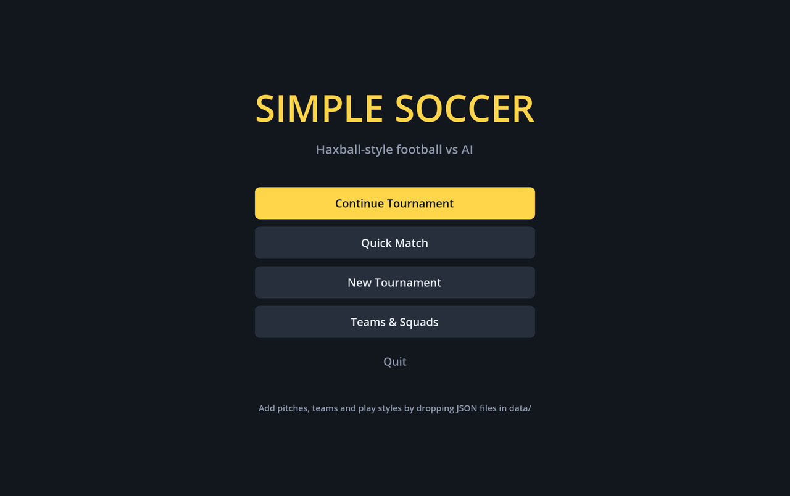
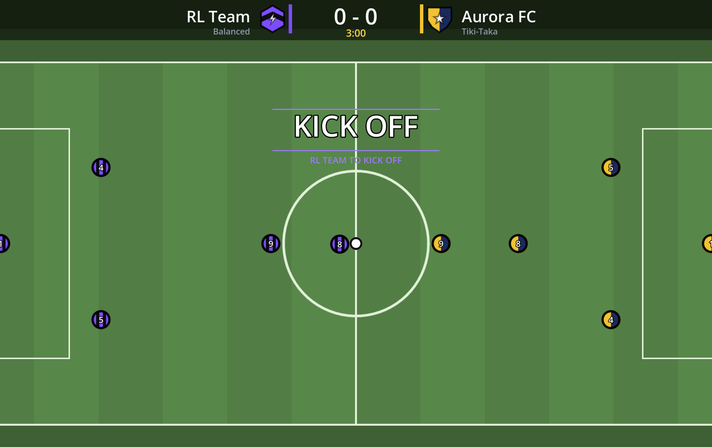
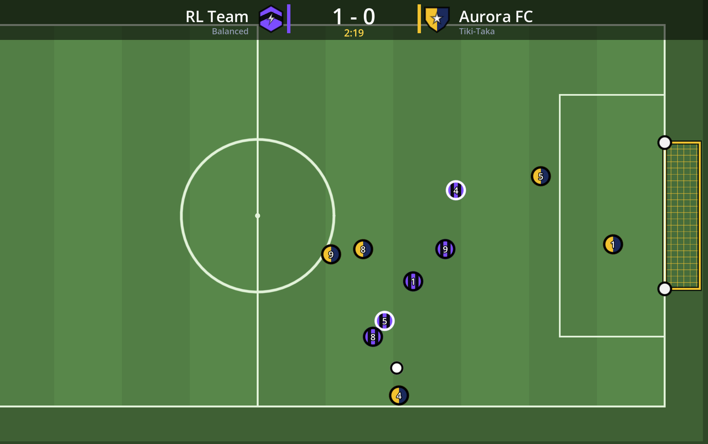
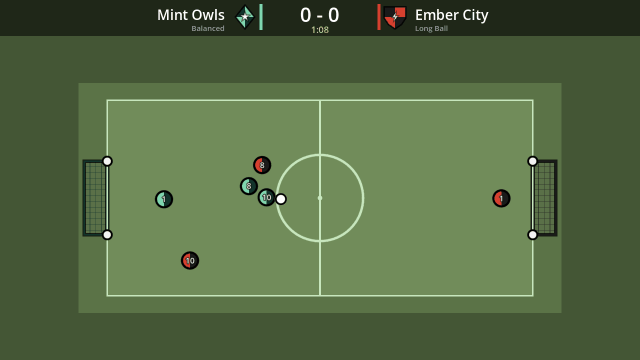
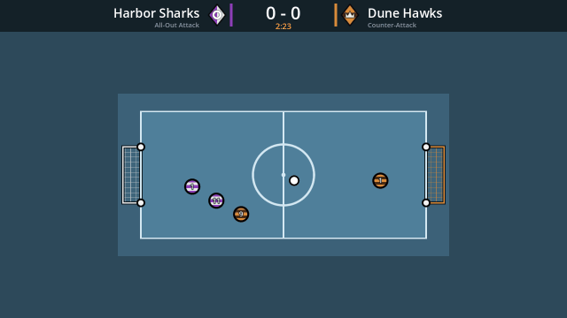
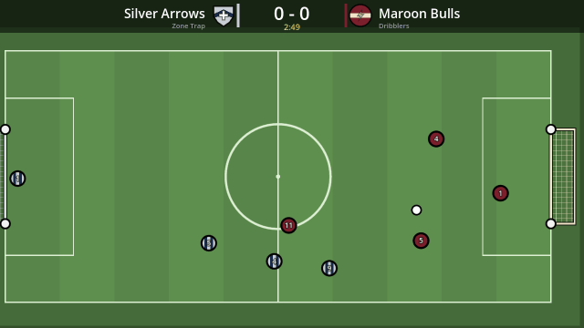
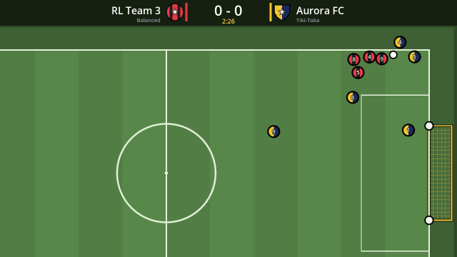

<p align="center">
  
</p>

# Simple Soccer

A Haxball-style football game in the browser, built for AI experiments: custom 60 Hz Haxball physics, data-driven pitches/teams/styles, rule-based and reinforcement-learning AI, per-player stats and grades, and tournaments.

```bash
python3 web/app.py
```

Then open <http://localhost:8080/#/game> (from another computer: `http://<this machine>:8080`). It needs Python 3 with numpy; the
same page has the **Lab** (the experiment dashboard) next to the **Game**. Dependencies are listed in `pyproject.toml` (numpy;
torch for training); nothing needs installing, every script runs from the checkout as `python3 <dir>/<script>.py`. On the Raspberry Pi the service `soccer-dashboard` runs it.

## Screenshots

| | |
|---|---|
| <br>**Main menu** | <br>**Quick match setup**: pitch, size, teams, formations, control |
| <br>**Kickoff**: the camera zooms in before the whistle | <br>**Live match**: RL Team vs Aurora FC, 5v5 on the arena pitch |
| <br>**Teams & squads**: logos, kits, rosters, styles, star ratings | <br>**Tournament setup**: league, knockout or groups + knockout |


*Match report: score, scorers, team stats and a 3.0-10.0 grade for every player.*

**UI work: follow [docs/design.md](docs/design.md)** (tokens, components, screen layouts). The screenshots and GIFs were captured from the earlier Godot version of the game; the browser game draws the same screens.

## Match gallery

Goals from different pitches, sizes and teams (all AI vs AI):

| | |
|---|---|
| <br>**Classic 3v3**: Owls vs Ember | <br>**Futsal 2v2**: Harbor Sharks vs Dune Hawks |
| <br>**Big pitch 4v4**: Arrows vs Bulls | <br>**Big with pillars 5v5**: Rose vs Tide |

## Controls
Arrows/WASD move, X/Space kick, Q switch player (Team mode), T sim speed (x1 / x2 / x4 / x8), Esc/P pause, M (while paused) quit the match, Enter continue after the final whistle. Main menu: Up / Down and Enter. On the team select (Quick match): Tab or a click picks the side, Left / Right its team, Up / Down its league, S swaps the teams, R random teams, Enter kicks off, Esc back to the menu. In the other menus: Left / Right change a focused picker, Enter starts, Esc goes back.

## Team strength & kickoff
There are no difficulty levels. A bot is exactly as good as its player's attributes (`soccer/ai/__init__.py` `attach_attributes`: reaction -> perception delay, finishing/passing -> aim error, positioning -> position noise, defending -> marking, passing/positioning/reaction -> decision speed), identically for allies and opponents. Strong teams are teams with strong players (16 teams span ~55 to ~84 base rating, 4 per tier, see `tools/generate_data.py`). Kickoffs use a random taker, direction and short delay (seeded by the match seed).

## Modes
- Quick match (the team select): two halves in the two teams' colours, each with its league, a crest carousel (the neighbouring teams of the league beside the picked one; click one to jump), a faint large crest behind, a You / AI badge (you always play the home side; the swap button or S swaps the teams), **Elo** (the latest
  ranking, `exp/ladder_ratings.jsonl`) and one sentence on **how the team plays**, measured, not designed: `game/profiles.py` plays
  every team 16 scouting matches and stores the statistics in `data/team_profiles.json`; `game/api.py` `describe` turns what sets a
  team apart from its league (with the ball; without it; how it scores) into the sentence. Re-run `python3 game/profiles.py` after
  adding teams or nets (on the Pi too: nets that only exist in `out_5v5/ckpt/` are profiled there; until then they show "Play style not measured yet"). Formations use each team's default. The bar underneath: players per side, minutes, control (one player /
  whole team / watch), recording; More: the pitch.
- **Dataset** ("Record my play", on by default, remembered in the browser): every match you play is saved as a training file for
  imitation learning (`data/human/`, see "Recording your play" below). A red REC mark shows in the corner while it records.
- Two leagues: the **Rule Based League** (16 fictional teams driven by the handmade AI styles, plus **Opus 5.5 High**, a team with its own team brain, see below) and the **Reinforcement Learning League** (the RL Teams, plus every net of the Elo ranking as its own team: the best checkpoint of each finished run, jit8, t48_u100, ...; they play with RL Team 5's squad, as in the ranking, with generated names, colours and crests). Each side picks a league (a list, so more leagues fit), then a team from it; teams are ordered by Elo.
- Teams and squads: one league at a time (the league list at the top, or Left / Right), strongest first; the picked team in its colours with its Elo, how it plays and its squad. Enter starts a quick match with it.
- Tournament: pick your team (Left / Right, R random), a league or **All leagues** (a mixed tournament of every team), then league, knockout, or groups + knockout among its teams (saved in the browser, so it continues where you left it). Knockout and groups need 4, 8 or 16 teams; other counts play a round robin. Knockout draws: golden goal, then penalties.
- Report after each match: score, scorers, team stats, player grades (3.0-10.0), man of the match.

## Architecture
Four parts, each using the one below it:

```
web/      the web app: one server (app.py) and the page, with two areas: Game and Lab
game/     the game's back end: catalog, match setup, tournaments, live matches (the pages are web/game/)
lab/      experiments on the Pi: queue, runner, Lab API, live demo match, agent CLI (the pages are web/lab/)
rl/       training and evaluation of the net teams (PPO, environment, league / head-to-head / scouting)
soccer/   the match core (Python): physics, rules, stats, grades, rule-based and net AI
data/     pitches, styles, teams, formations, shipped nets (JSON)
```

- `soccer/` (no UI): `data.py` (pitches, styles, teams, formations, line-ups, kit colours), `match.py` (the simulation,
  60 ticks/s), `stats.py`, `rating.py`, `rng.py` (Godot's random generator, bit for bit), `ai/` (`opus.py` the Opus 5.5 High team brain, `rules.py` team brain and
  rule bots, `nets.py` net teams and observations).
- `game/`: `api.py` (catalog, a match setup -> `MatchConfig`, whole matches simulated on all cores), `tournament.py`
  (fixtures, standings, statistics), `session.py` (a live match over a WebSocket), `routes.py` (the HTTP API).
- `web/`: `app.py` (the server, standard library only: static files, `/api/game/...`, `/ws/match`, and the Lab's API from
  `lab/dashboard.py`), `ws.py` (a minimal WebSocket), `index.html` (the shell with the Game / Lab switch), `game.js` +
  `game/*.js` + `game.css` + `draw.js` (the game, ES modules: `game/core.js` state and helpers, one module per screen,
  `game/render.js` the match on the canvas; logos and kits in `draw.js`), `lab/*.js` + `style.css` (the Lab: plain scripts
  loaded in order, one per page, `lab/core.js` helpers and charts, `lab/app.js` routing and start-up).
- `rl/` ([rl/README.md](rl/README.md)): `env.py`, `client.py`, `agent.py`, `selfplay.py`, `distill.py`, `evaluate.py`,
  `eval_checkpoint.py`, `export_team.py`, `selfplay_args.py` (the training options, without torch).
- `lab/` ([lab/README.md](lab/README.md)): `exp_runner.py`, `tracker.py`, `lab.py`, `dashboard.py` (Lab API), `live.py`,
  `systemd/`. Results and specs live in `exp/`, checkpoints in `out_5v5/`, logs in `logs/`.
- `tests/` regression tests of the core, training environment, evaluations, tournaments and the web app (see "Tests"); `tools/`
  `bench.py` (core speed), `team_bench.py` (one team against the league / RL teams / trained nets: points, goals, and how
  much it plays as a team), `tune_opus.py` (CMA-ES tuning of the Opus team brain against trained nets), `generate_data.py` (regenerates `data/`, seeded; style tuning lives there); `docs/` notebook,
  rewards, pipeline design, UI design guide, old results.

### Bot quality and team AI (how a team gets strong or weak)
- Per player (`soccer/ai/__init__.py`): reaction -> perception delay, finishing/passing -> aim error, positioning -> position noise, defending -> marking tightness and lane cover, vision (passing+positioning+reaction) -> decision speed, how clean a pass lane must be, and shot-lane choice.
- Ball carrier (`soccer/ai/rules.py` `StyleBot._decide_action`): shoots at the goal-mouth point whose line is furthest from every opponent (keeper included), takes longer shots when the lane is open, dribbles by scoring 7 headings against opponents' positions and momentum, and rates passes by receiver space plus whether an opponent can reach the lane before the ball (`_pass_margin`, ball travel time from the real kick speed and damping).
- Ball physics is fixed (a kick adds exactly 5 px/tick to the ball's current velocity, damping 0.99/tick), so the bots predict the ball: `intercept` (`soccer/ai/rules.py`) finds the earliest point on the ball's path a player can reach (chasers run to it, and an off-ball *interceptor* is sent onto an opponent's pass/shot, `style.intercept`); `_compensated_dir` corrects the kick direction for the ball's velocity so passes/shots on a moving ball go where intended.
- Game management (`TeamBrain.urgency`): in the last ~45 % of the match a team that is behind pushes up, shoots earlier and presses with one more player; a team that is ahead drops deeper.
- Team strength comes from `tools/generate_data.py` (`base`). The UI shows each team's Elo from the ranking (`lab/ladder.py`) instead of the old attribute rating and stars.

### Opus 5.5 High (`soccer/ai/opus.py`)
Full write-up with the maths, plots and screenshots: [docs/opus_5_5_high.md](docs/opus_5_5_high.md).

A Rule Based League team with its own team brain (`OpusBrain` + `OpusBot`, chosen by `"brain": "opus"` in its style). Same senses
and limits as every bot (perception delay, aim error, position noise and decision speed from the attributes, which are those of
Silver Arrows, the strongest handmade team), so the difference is only how it plays:
- **Jobs, not a swarm**: exactly one outfield player plays the ball (whoever gets there first). With the ball, one player stays
  back as the rest defence, the most advanced supporter goes to the goal as striker beyond halfway and the others take open
  support spots (value of the spot, pass lane, distance to opponents, spread from team-mates). Without it, one presser
  approaches goal-side, one covers between ball and goal, the others mark the most dangerous receivers; near our goal a marker
  whose man is already in a scramble guards the far half of the goal mouth instead of piling in. The keeper keeps goal and only
  plays balls he wins in his own box. In our own half the team only switches to attack when the ball is clearly ours.
- **Every kick is simulated** (build-up and midfield): the ball path of 40+ directions, straight passes and shots (three aim
  samples each for the player's aim error) and when every player can reach it (exact player dynamics: current momentum plus full
  acceleration after his reaction delay). Who touches first decides the value (receiver's spot and space, or the danger of losing
  it; shots: chance nobody reaches it before the line, with a reading delay for defenders and a rebound value). The kick that is
  actually taken is the one the contact gives right now, evaluated fresh, so a pass never goes off by the line-up tolerance.
  Pass predictions are calibrated: passes rated over 95 % safe are kept about 90 % of the time.
- **Opponents' half**: the carrier drives at goal and shoots like the handmade bots (`StyleBot._decide_action` with the Opus
  style), with the Opus shape around him.
- **Tuned**: its constants (distances, margins, value weights, four style values) were tuned with CMA-ES against 10 trained nets
  (`tools/tune_opus.py`), twice. The second run (31 numbers) added a territory term (deep in our half, a kick that gains ground
  is worth more even if it may be lost) and an outlet player who stays up when we defend deep. Fresh seeds, second run vs first:
  +0.44 points and +0.47 goal difference per match against the nets (z 4.5 / 4.9); against every other ladder entry
  1.18 -> 1.53 points per match (z 2.8).
- Elo (the Lab's ranking, `lab/ladder.py`, as `rules:opus_high`): **1613 ± 134 after 180 games** of the current version (the
  version bump reset it; the first tuned version had 1664 ± 154 from 60 games, 1471 before tuning): the top rule team by ~300
  points, in the middle of the trained nets. The one-off round robin before tuning is in [docs/elo_ranking.md](docs/elo_ranking.md).
- Measured with `python3 tools/team_bench.py opus_high --rl` (5v5 arena, 3 min, both sides, 2 seeds): 2.10 points per match
  against the 16 rule teams and RL Team 4/5 (1.36 goals for, 0.47 against). It plays as a team: 3+ of its outfield players are
  within 120 px of the ball ~6 % of the time (Silver Arrows ~5 %, RL Team 5 ~28 %), ~19 passes per match at ~80 % completion
  (Silver Arrows ~10 at ~60 %), a quarter of its goals assisted.

Physics is identical for every team. Attributes (finishing, passing, defending, positioning, reaction) and styles only change AI behaviour.

## Adding content
- Pitch: `data/pitches/<id>.json` (copy `classic.json`).
- Style: `data/styles/<id>.json` (line_height, compactness, width, press, marking, directness, shoot_range, pass_bias, risk, keeper_sweep, forward_stay, support_dist, fluidity, attack_commit). `fluidity` 0 = fixed goalkeeper, 1 = whoever is rearmost keeps goal; `attack_commit` = how many players join the attack. Strategy params: `intercept` (run onto the ball path of opponent passes/shots), `counter_press` (extra chasers right after losing the ball), `long_shot` (shoot from range when the lane is open), `switch_play` (prefer passes to the far side). `brain`: `"rules"` (default) or `"opus"` (the Opus team brain, `soccer/ai/opus.py`). 17 styles ship: opus_high, balanced, tiki_taka, high_press, park_the_bus, counter_attack, long_ball, wing_play, total_football, catenaccio, all_out_attack, gegenpress, sharpshooters, man_to_man, zone_trap, dribblers, switch_play.
- Team: `data/teams/<id>.json`. Optional `"league"`: `"rules"` or `"rl"`; without it a team with an `ml_model` joins the RL league, every other team the rule-based one. A rule team added after the original 16 sets `"rl_eval": false`, so the RL evaluation league (`rl/evaluate.py`, `rl/teams_info.json`) and every earlier evaluation stay comparable.
- Formation: `data/formations.json`, slots `[role, fx, fy]`.

## How the browser plays a match (`game/session.py`)
The page opens a WebSocket (`/ws/match`) and sends the match setup (teams, pitch, size, length, seed, control, formations).
The server builds the match on the core and plays it in real time: 60 ticks a second, each one sent to the page (positions,
score, clock, goal and kickoff state, goal events); the page sends the keys back when they change. At every kickoff the
match is held for 130 ticks while the camera zooms in, as in the Godot game. After the final whistle the server sends the
result, which the report shows. Tournament rounds are simulated in one request (`/api/game/tournament`, all cores).
- Recording your play (`game/recorder.py`): with `"record": true` in the setup, every 2 ticks while you control a player in play,
  one row: the 46-number observation of your player (the nets' input), the raw positions and speeds of everyone and the ball, your
  direction as one of the nets' 9 moves (in your player's own frame) and your kick. One compressed `.npz` per match in
  `data/human/` (versioned in git with Git LFS, about 1 MB per 90 s), written at the final whistle, or when you quit after at least 10 s.
  `python3 il/human_data.py [--check]` lists the files (and rebuilds every observation from the raw state). Plan:
  [docs/imitation_plan.md](docs/imitation_plan.md).
- A net plays a team through `MatchConfig.nets[team]` (`{"model": path}` or `{"dict": model}`, loaded in the match's own
  process); a team with `ml_model` in its JSON gets its net automatically.
- Speed (`python3 tools/bench.py`, on a Mac): rule-vs-rule 5v5 about 10,600 ticks/s (177x real time), the training
  environment about 5,700 steps/s per process. The Godot implementation did about 7,200 and 3,400.

## Tests
```bash
python3 tests/run_all.py            # everything, about 40 s; no Godot or other setup needed
sh .githooks/install.sh             # once per computer you write code on: runs the tests before every push that changes code
```
With the hook installed, a push whose commits change code runs the tests first and is stopped if one fails (`git push
--no-verify` skips it once); pushes of results, notes or docs only (`exp/`, `docs/`, `*.md`) are not held up. Not on the Pi:
its pushes are results, and another CPU / maths library may not reproduce the stored match results bit for bit.
Regression tests: each one plays fixed, seeded cases with the current code and compares them with the reference results in
`tests/golden/`. A FAIL means the code now behaves differently. If that is intended (a physics, AI, reward or report change),
re-record with `--update` (one test or `run_all.py --update`) and commit the new files together with the change. Matches are
chaotic, so on another machine (other CPU / maths library) a float difference in the last bit can grow into a FAIL; the files
say where they were recorded.
- `tests/test_rng.py`: the random generator's outputs for 6 seeds (every seed, kickoff and random start comes from it).
- `tests/test_match.py`: the 17 matches of `tests/scenarios.json` (all sizes, every pitch plus one with extra walls, net teams,
  a scripted human in single and team control, overtime, shootouts, score limit): score, ball position and speed every second
  (a FAIL names the first second that differs) and the complete result (events, statistics, grades).
- `tests/test_env.py`: the 7 training environments of `tests/env_scenarios.json` (every reward term, random layouts, curricula,
  self-play with a net, external opponents) with seeded random actions: every step's reward, every episode end, every reward
  term's total and the observation after each reset.
- `tests/test_evaluate.py`: the league, head-to-head and behaviour / scouting reports of `rl/evaluate.py`, line for line (the
  Lab parses these lines), and `rl/teams_info.json` against `data/teams`.
- `tests/test_tournament.py`: 8 tournaments of every format with made-up results: teams, fixtures, match seeds, standings and
  statistics, and the knockout round names.
- `tests/test_web.py`: the web app serves its pages and APIs, a match played live over the WebSocket ends exactly like the same
  setup simulated in one go, the keys move the player, a recorded match saves the right file (the picked keeper, the keys as net
  moves, observations rebuildable from the state) and unrecorded ones save nothing, a tournament can be created, played and
  simulated.

The Python core started as an exact port of the Godot game (the last commit with `scripts/core/match_sim.gd` is `f25e81b`);
until Godot was removed the tests replayed that implementation tick by tick (61,000 match ticks, 17,000 environment steps and
58,000 AI decisions identical). Those Godot-based tests are in the git history before the switch to `tests/golden/`.

## Experiments
RL experiments run unattended on the Raspberry Pi through a queue (`exp/queue/`), a runner service and a web dashboard on port 8080: see [lab/README.md](lab/README.md) and [docs/experiment_pipeline.md](docs/experiment_pipeline.md).

## Machine learning

<p align="center"></p>

*Two RL teams playing each other (RL Team 2 vs RL Team 4).*
The RL teams are trained with PPO in Python (`rl/`, see [rl/README.md](rl/README.md)) on the match core.
The earlier GDScript experiments (imitation learning, DAgger and evolution strategies against the rule bots) are in the git
history before the move of the AI to Python.

**Raspberry Pi notes:** `rl/README.md` (setup, `--w_jitter` anti-twitch reward); the Lab's Live page plays the newest checkpoint of the running experiment (`lab/live.py`).

## Team control mode
`MatchConfig.ControlMode.TEAM`: Q switches to the teammate nearest the ball; `auto_switch` does it automatically (`soccer/match.py` `set_controlled` / `switch_controlled`).

## Not included (by design)
Fatigue, fouls, offside, substitutions.


## Player grades

`soccer/rating.py` turns events into a 1-10 grade: 6.0 plus an "impact" summed from goals, shot quality
(xG), assists/key passes (xA), each pass (progress, pressure, where it was lost), dribbles and dispossessions,
tackles vs interceptions vs loose-ball recoveries, clearances, blocks, goalkeeping (save difficulty, goals
conceded vs xG) and clean sheets. Weights are per role *played* (whoever was in goal most of the match is graded
as GK). `ROLE_OFFSET` was calibrated with batches of simulated matches so every role averages about 6.4
(p10 about 5.1, p90 about 7.9). Raw counters live in `soccer/stats.py`.


## Human control and keeper (AI notes)

- A human-controlled player is never picked as keeper, chaser or marker by the team brain; bots give him room
  (`StyleBot._avoid_human`) and do not send a second chaser at the ball when he is on it.
- The keeper reads the shot path and runs to the earliest point he can reach (slow acceleration is modelled),
  comes out to narrow the angle (`KEEP_*` in `soccer/ai/rules.py`), and only charges a loose ball when he wins the race to it.

## Goals and kickoffs

- After a goal the scorer's bot teammates run to him and huddle (the human-controlled player is never steered, he can move freely); the pause
  lasts 2.5-4.3 s depending on how far they have to run (`soccer/match.py` `goal_pause`). The view adds rings and confetti.
- At kickoff the kicking team may use the whole centre circle, including the part on the opponents' side, so the
  ball can be played backwards. The other team stays out of the circle and in its own half.

- A goal only counts once the whole ball is over the goal line (centre beyond `half_w + ball.radius`).
- Goal frames are drawn in the kit colour that contrasts most with the pitch (brightened if still too close, with a
  dark outline), so a green team on a green pitch stays readable (`MatchView._goal_colour`).

## RL team (plays like the trained net)

<p align="center"></p>

*RL Team 4 (cooperation fine-tune) scoring against Cobalt.*

<p align="center"></p>

*RL Team 3 vs Aurora.*
League result of the shipped weights: 61 W, 3 D, 0 L in 64 full matches against the 16 rule-based teams (2.91 pts/match, 5.1 goals for and 1.1 against per match); details in `docs/history/results_league_final.txt`.
`data/teams/rl_team.json` ("RL Team") has `"ml_model": "res://data/models/rl_5v5_arena.json"`: all 5 players,
keeper included, are driven by a net trained with Python PPO (`rl/`, see `rl/README.md`). Pick it in Quick match /
Tournament like any other team, on the **5v5** size (the arena pitch is what it trained on). On other sizes the net
does not fit and the team falls back to its rule-based style. Any team can use a net the same way via `ml_model`.

`data/teams/rl_team_2.json` ("RL Team 2") uses `data/models/rl_5v5_arena_v2.json`: the same net after extra self-play / league training
(`rl/selfplay.py`) with human-likeness rewards (pass quality, spacing, kick discipline). "RL Team" keeps the original validated weights.

`data/teams/rl_team_3.json` ("RL Team 3") uses `data/models/rl_5v5_arena_v3.json`: the self-play snapshot at update 500 (league 2.97 pts/match,
0.27 goals against; kick discipline and spacing close to the rule bots, see `docs/history/results_selfplay.txt`).

`data/teams/rl_team_4.json` ("RL Team 4") uses `data/models/rl_5v5_arena_v4.json`: a cooperation fine-tune of RL Team 3 (individual pass credit,
key-pass / expected-assist rewards, "stand open" reward; snapshot at update 600). League 3.00 pts/match (64/64 wins), about 3x the key passes of
RL Team 3 (4.25 vs 1.38 per match); it concedes a bit more (0.48 goals/match) and its keeper roams further.

`data/teams/rl_team_5.json` ("RL Team 5") uses `data/models/rl_5v5_arena_v5.json`: cooperation fine-tune with anti-farming rewards (cooperation cap per match, keeper-stays-home penalty)
and 60% fully random starting layouts (`coop5`, update 1200). About 4.6 key passes per match like RL Team 4, but no reward farming and a keeper that stays closer to its goal (137 px).
