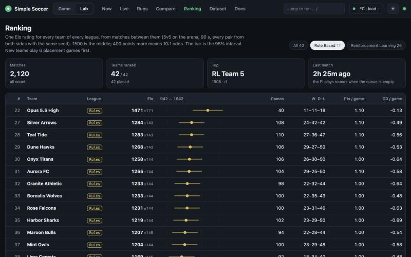
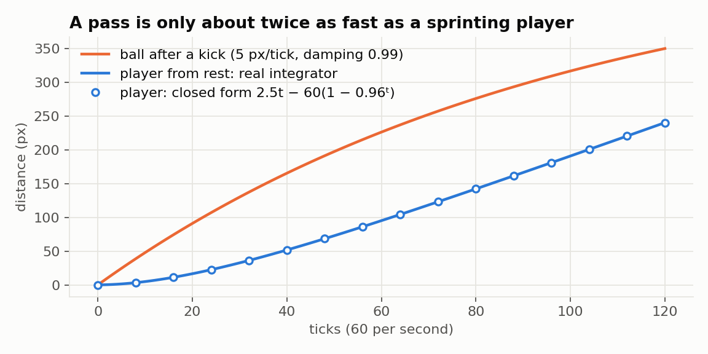
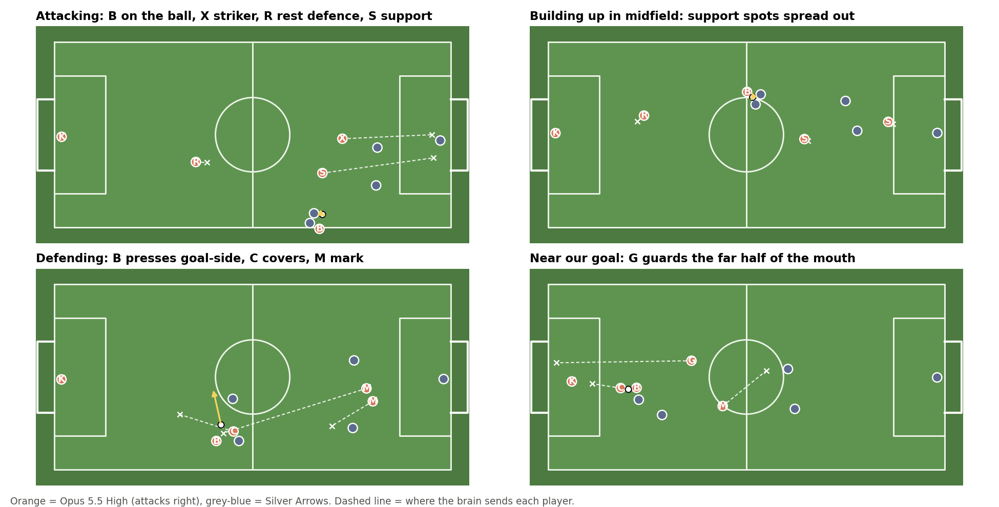
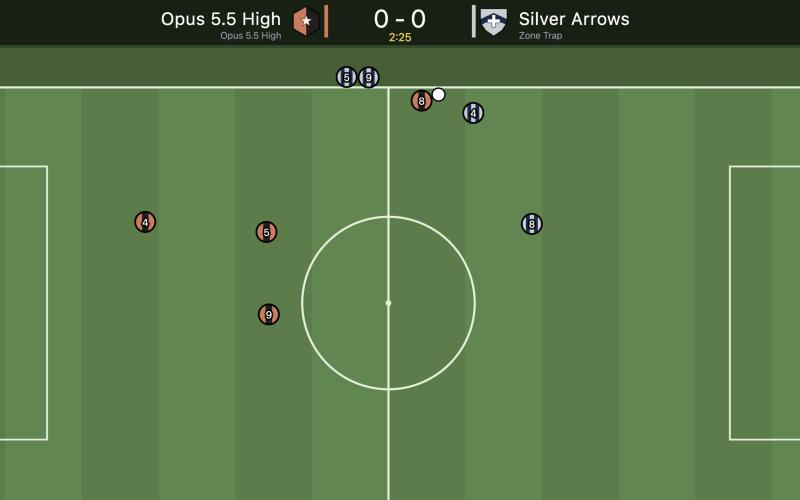
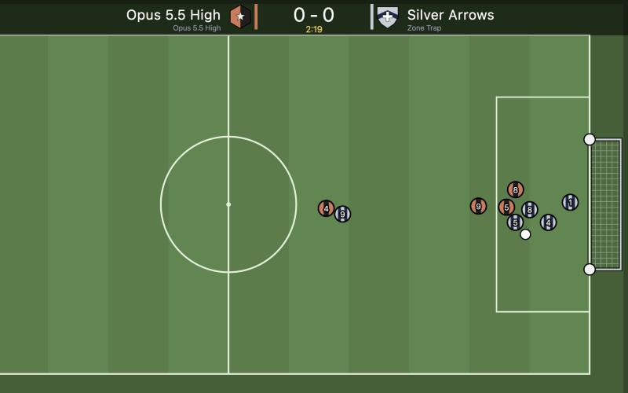
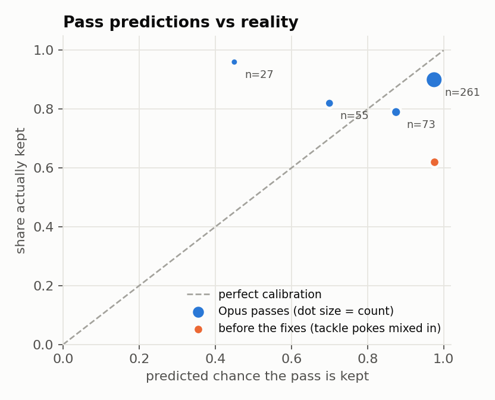
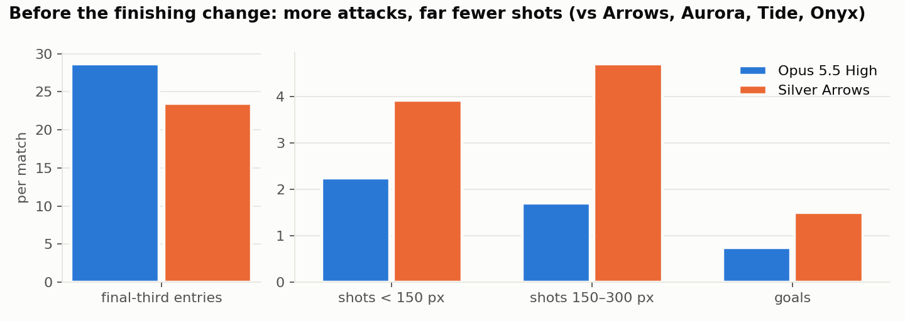
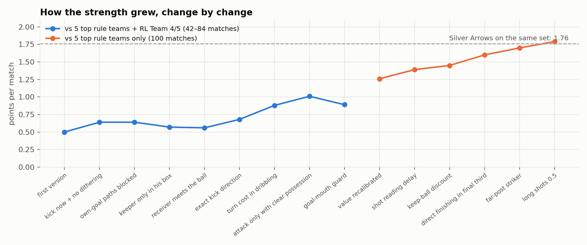
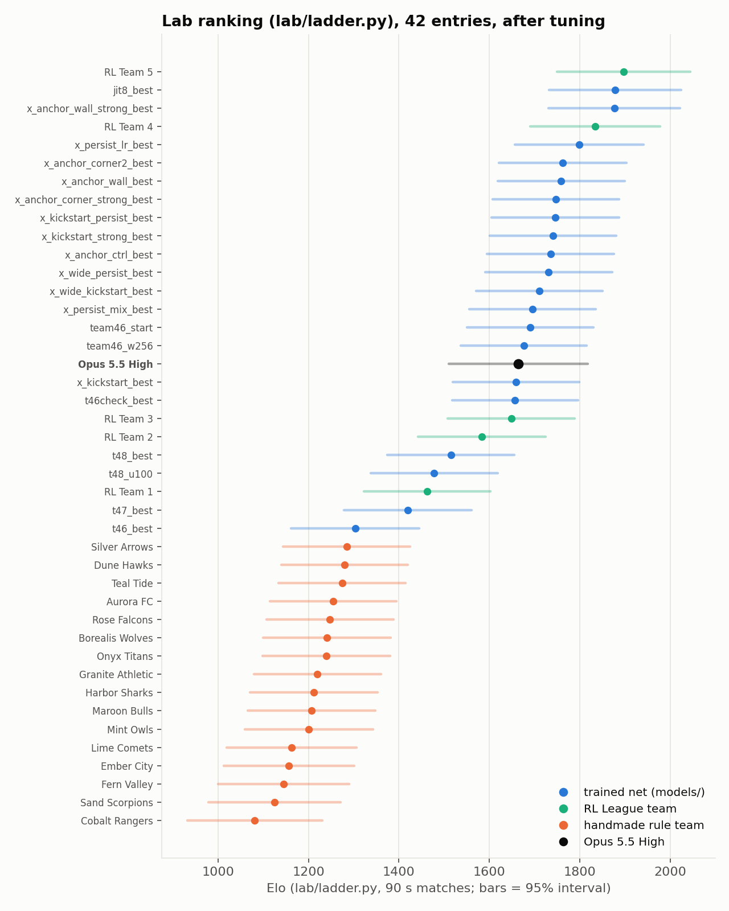
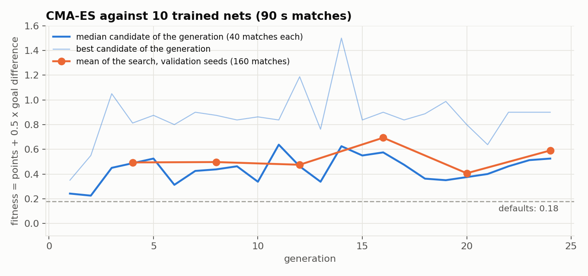

# Opus 5.5 High: how the team was built, and where it stands

Opus 5.5 High is a team for the **Rule Based League**: no neural net, no training, a hand-written team brain
([`soccer/ai/opus.py`](../soccer/ai/opus.py)). The brief: the strongest bot possible under one rule, **it must look like real
football**. The players cooperate to win; they don't all run after the ball.

This document explains how it works (with the maths), how it was built change by change, what the numbers say, and where it falls
short.

| | |
|---|---|
|  |  |
| *Quick Match: Opus 5.5 High has Silver Arrows' players (rating 89), so the difference comes from the AI.* | *The Lab ranking filtered to the Rule Based League: Opus is the top rule team.* |

## In one minute

- **Plays as a team.** At any moment exactly one outfield player plays the ball; the other three have jobs (rest defence,
  striker, support / cover, marking). It has 3+ outfield players around the ball **4 % of the time** (Silver Arrows 5 %, RL Team 5
  28 %) and plays **~23 passes a match at 79 %** (Silver Arrows ~10 at 59 %).
- **Thinks with physics.** In build-up it simulates ~50 kicks per decision (three aim samples each) and every player's exact
  reach, and picks the kick by who gets to the ball first and what that is worth.
- **Tuned against the nets.** 27 of its numbers were tuned overnight with CMA-ES against 10 trained nets; on fresh seeds that
  added +0.33 points and +0.55 goal difference per match against the nets (z = 3.2 and 4.9).
- **Strength:**
  - **Lab ranking:** **1664 ± 154 Elo, 17th of 42**: the top rule team by ~380 points (Silver Arrows 1284), above RL Team 2 and
    RL Team 3, level with the team46 nets.
  - **Trained nets:** still behind the best ones (RL Team 5 ~1897, jit8 ~1879), but it now takes points off them: in its 60
    ladder games it is 21-19-20, including a win and a draw against RL Team 5.
  - **Against the 16 rule teams:** ~1.9 points per match, positive record against every one of them.


*A live match in the browser, before tuning (Opus in orange defends the left goal). One player (#5) engages the man on the ball; the others hold
cover and marking positions and the keeper stays in goal: no swarm.*

---

## 1. The physics that decide everything

The match core is a deterministic Haxball-style simulation at 60 ticks per second (`soccer/match.py`). Three facts shape every
decision.

**The ball.** A kick adds exactly $K = 5$ px/tick to the ball's velocity along the line from the player's centre to the ball's
centre; the ball then loses 1 % of its speed per tick. After a kick with initial velocity $\mathbf v_0$ from $\mathbf b_0$:

$$\mathbf b(t) = \mathbf b_0 + \mathbf v_0\,\frac{1-0.99^{\,t}}{0.01},\qquad |\mathbf v(t)| = |\mathbf v_0|\,0.99^{\,t}$$

so a kick from rest travels at most 500 px, and a 200 px pass takes ~51 ticks. Side walls bounce it back at half speed.

**The players.** Each tick: $\mathbf v \leftarrow 0.96\,(\mathbf v + 0.1\,\mathbf u)$, $\mathbf x \leftarrow \mathbf x + \mathbf v$ with
$|\mathbf u| \le 1$. The system is linear, so a player's position is a *free* part (his current velocity carrying him on) plus a
*forced* part (what he can add by accelerating after his reaction delay $\tau$):

$$\mathbf x(t) = \mathbf x_0 + 25\,\mathbf v_0\,(1-0.96^{\,t}) + \mathbf u\,R(t-\tau),\qquad R(s) = 2.5\,s - 60\,(1-0.96^{\,s})$$

$R$ is how far a player starting from rest can get in $s$ ticks (top speed 2.5 px per tick of movement). The closed form matches
the integrator exactly:



The consequence: **a pass is only about twice as fast as a sprinting player**, so whether a pass arrives is a race that can be
computed.

**Kicking a moving ball.** The kick adds $K\mathbf n$ to the ball's current velocity $\mathbf v$. To send the ball along a
direction $\mathbf d$, solve $\mathbf v + K\mathbf n = s\,\mathbf d$ for the speed $s>0$:

$$s = (\mathbf v\cdot\mathbf d) + \sqrt{(\mathbf v\cdot\mathbf d)^2 - |\mathbf v|^2 + K^2},\qquad \mathbf n = \frac{s\,\mathbf d - \mathbf v}{K}$$

(`_compensated_dir`, shared with the handmade bots). A one-touch pass on a moving ball goes where it was meant to go.

---

## 2. The team brain: jobs, not a swarm

`OpusBrain.update` runs every 2 ticks and gives every player one job. Each bot then executes its job with its own senses and skill.
Perception delay, aim error, positioning noise and decision speed come from the player's attributes, exactly as for every other
team.

**Who plays the ball.** For each player the brain computes the earliest tick he can touch the ball on its predicted path
(`intercept`): $t_{us}$ for our best, $t_{them}$ for theirs. The phase:

$$\text{attack if } t_{us} + 4 + 21.8\,\delta < t_{them},\qquad \text{defend if } t_{them} + 4 < t_{us},\qquad \text{otherwise contest}$$

where $\delta \in [0,1]$ is how deep the ball is in our own half. Deep in our half the team only switches to attack when the
ball is clearly ours; a scramble near our goal keeps the defensive shape. Only the first player to the ball plays it (with a
small bonus for whoever already had the job, so it doesn't flicker).

| Job | When | What it does |
|---|---|---|
| **B** ball player | always one | attack: picks a kick or carries the ball (section 3); defend: presses from the goal side |
| **K** keeper | always | the nominal goalkeeper; shot-stopping from the handmade bots; plays the ball only in his own box when he is first |
| **R** rest defence | attack | the deepest free player stays ~370 px behind the ball against the counter |
| **X** striker | attack, beyond halfway | goes to the goal, ~60 px in front of the goal line |
| **S** support | attack | best open spot on a 55 px grid (below) |
| **C** cover | defend, ball not deep in their half | goal-side behind the presser, 140 px towards our goal |
| **M** marker | defend | goal-side of the most dangerous receivers, 44 to 73 px off them |
| **G** guard | defend, scramble near our goal | the far half of the goal mouth instead of joining the pile |

The support spot for each free player maximises

$$S(\mathbf p) = 1.6\,\tfrac{V(\mathbf p)}{0.35} + 0.22\,\min\!\big(\tfrac{d_{opp}}{130},1\big) + 0.22\,\min\!\big(\tfrac{\ell}{70},1\big) - \text{(too close / too far from the ball)} - \text{(near team-mates)} - 0.0006\,|\mathbf p - \mathbf x|$$

with $V$ the position value (section 3), $d_{opp}$ the distance to the nearest opponent, $\ell$ the clearance of the pass lane from
the ball (spots between 84 and 307 px from the ball); team-mates already placed push each other apart within 184 px. The numbers
in this document are the tuned values (section 8 lists the hand-set ones they replaced).


*Real moments from a match against Silver Arrows (tuned version), drawn from the simulation. Dashed lines go to where the brain sends each player.*

| | |
|---|---|
|  |  |
| *Before tuning. Build-up on the touchline: #8 on the ball, #5 and #9 offer passes, #4 stays back.* | *Attacking the box: #8 and #5 inside, #9 at the edge, #4 at halfway marking the counter.* |

---

## 3. Choosing a kick by simulating it

In build-up and midfield the ball player scores every option instead of following fixed rules.

**Candidates.** 40 directions (every 9°), a direct pass at each team-mate and 9 points across the goal mouth: about 50 kicks.
Each is simulated three times, at $-\sigma, 0, +\sigma$ of the player's aim error ($\sigma$ from his passing or finishing), and the
values are averaged with weights $\tfrac14,\tfrac12,\tfrac14$.

**Who gets there first.** For every player $i$ and every sample time $t$ of a path, the *deficit* is how far he still is from
touching the ball when it gets there:

$$D_i(t) = \Big|\,\mathbf b(t) - \big(\mathbf x_i + 25\,\mathbf v_i\,(1-0.96^{\,t})\big)\Big| - r - R\big(t - \tau_i\big)$$

with contact radius $r$ (15 px for a receiver, 24 px for an opponent: any touch deflects it) and $\tau_i$ = his reaction delay
+ 2 ticks. The first sample where $D_i \le 0$ is his arrival $k_i$. Lining up a kick that needs the kicker to turn costs
$28\,(1-\cos\theta)$ ticks, which delays our receivers and gives the opponents time. All of this is one vectorised numpy
computation: (players × paths × samples), about 50 × 3 × 75 × 9 numbers per decision.

**What it is worth.** With $k_m$ our first arrival and $k_o$ theirs (in samples of 2 ticks):

$$P_{\text{keep}} = \sigma\!\left(\frac{2(k_o-k_m) - 6}{5}\right),\qquad \text{value} = P_{\text{keep}}\,V_{\text{recv}} - (1-P_{\text{keep}})\,V_{\text{them}}(\text{catch point})$$

$V$ is the **position value**, an estimate of how likely possession at a point ends in a goal:

$$V(\mathbf p) = 0.01 + 0.327\,\mathrm{xG}(\mathbf p) + 0.0425\,\pi^2,\qquad \mathrm{xG}(\mathbf p) = \mathrm{clip}\!\left(0.75\,(\theta/1.8)^{1.6},\,0.01,\,0.8\right)$$

where $\theta$ is the angle the goal mouth subtends from $\mathbf p$ (the game's own xG, `soccer/rating.py`) and $\pi \in [0,1]$ is
progress up the pitch. The weights were first calibrated by hand to what attacks really yield (a few % per final-third entry;
an early version valued them about 5× too high and never shot), then tuned. A free team-mate near goal is worth the shot he gets:
$V_{\text{recv}} = \max\big(V\cdot(0.55 + 0.45\,\sigma(\cdot)),\; 1.35\,\mathrm{xG}\cdot\sigma(\tfrac{\text{space}-25}{12})\big)$.

**Shots.** A path that crosses the goal line before any team-mate touches it is a shot. Its margin $m$ is the opponents' smallest
deficit before the line, plus 38.6 px because defenders need a moment to read a shot's direction:

$$P_{\text{clean}} = \sigma\!\left(\frac{m + 38.6 - 2}{7}\right),\qquad \text{value} = 0.97\,P_{\text{clean}} + (1-P_{\text{clean}})\cdot\big(0.04 + 0.05\,n_{\text{box}}\big)$$

The last term is the rebound, worth more with team-mates near goal. A path that runs over **our own** goal line is never an option.

**Carrying the ball** is compared against the best kick: 16 headings, the value 70 px on, times the chance we are still first to
the ball there, discounted by 0.265 (most dribbles end in a loss) and penalised into the touchline or a corner.

**Kicking what is really on.** The plan is refreshed every few ticks, but the kick itself is decided at contact: the direction the
contact would give *right now* (contact normal plus the ball's velocity) is evaluated fresh. It is taken when it beats keeping the
ball and is close to the plan (or ≥ 43 % of it, or straight away when an opponent is within 62 px). Without this the player
circled the ball while the defenders closed in.


*One real decision: the ball player (B) simulated 53 kicks. Grey = an opponent gets there first; blue = we do (brighter = worth
more). He picks the through ball into the space ahead of the right-side supporter.*

**Is the simulation right?** Every kick logs its predicted success; after the fixes in section 6, passes rated over 95 % safe are
kept 90 % of the time (261 passes):



Shots, after adding the reading delay (24 px at the time): predicted 0.5 to 0.8 → 44 % scored (9 shots), predicted over 0.8 →
60 % (5 shots), predicted 0.2 to 0.5 → 8 % (13 shots).

---

## 4. Defending

- **Pressing from the goal side.** The presser runs round the ball to the side of our goal before engaging, so a touch or a kick
  sends the ball away from our goal. He only kicks when the evaluated kick is worth it; a blind poke is allowed only within 312 px of
  our goal. Before this rule the presser poked ~27 times a match and gave the ball back 89 % of the time.
- **Cover and markers.** The cover stands between ball and goal; markers take the most dangerous receivers by
  $V_{\text{them}}(\text{position}) + 0.15\,(\text{closeness to the ball})$ and stand goal-side, leaning towards the ball to cut
  the pass.
- **No pile-ups.** The trained nets score mostly from scrambles on the goal line with 3 to 4 players around the ball. When a
  marker's man is already in such a scramble near our goal, the marker guards the far half of the goal mouth instead (the keeper
  takes the near post). That one change cut the goals conceded to RL Team 4/5 from ~4.7 to ~3.4 per match.

## 5. Finishing

In the opponents' half the ball player switches to the handmade bots' direct finishing (`StyleBot._decide_action`: drive at goal,
shoot at the open part of the mouth, long shots when the lane is open), with the Opus shape around him: striker, support, rest
defence. (By hand this started at 35 % of the opponents' half; the tuning moved it to the halfway line.) The simulated choice was better at keeping the ball but worse at
scoring: before the switch Opus reached the final third more often than Silver Arrows (28.7 vs 23.4 times a match) but shot from
close range far less:



---

## 6. How it was built: every change, measured

Each change was tested with `tools/team_bench.py` (5v5 arena, 3-minute matches, both sides, fixed seeds) and kept only when it
helped. Problems were found by rendering the seconds before goals and failed passes frame by frame, and by logging every decision.



| Change | What was wrong | Effect |
|---|---|---|
| Kick now + no dithering | 572 pass decisions in a match, 38 kicks: the player kept circling the ball | passes started to happen |
| Own-goal paths blocked | a back-pass rolled into our own net: only the *opponents'* goal line was checked | conceded 2.36 → 1.71 per match |
| Loose-ball fix | a slow ball out of everyone's 160-tick horizon had nobody assigned | — |
| Keeper receives only in his box | 600 px back-passes to a keeper who (correctly) stays in goal | — |
| Contact radius 19 → 24 px, receiver meets the ball | passes rated 95 % safe were kept 62 % | 81 % completion |
| Exact kick direction | the line-up tolerance sent kicks up to 18° off the plan | 0.56 → 0.68 |
| No blind pokes | 27 pokes a match, 11 % kept | — |
| Turn cost when carrying | a carrier facing the wrong way dragged the ball backwards | 0.68 → 0.88 |
| Attack only with clear possession | scrambles in our box flipped the team to "attack" | 0.88 → 1.01 |
| Goal-mouth guard | 10-player pile-ups in our corner | conceded to RL 4.7 → 3.4 |
| Value recalibrated (÷5) | it never shot: holding the ball looked better than any shot | 1.26 (new benchmark) |
| Shot reading delay | the keeper was modelled as perfect | 1.39 |
| Planned vs taken shots | 599 shot plans, 59 shots taken | 1.45 |
| Direct finishing + far-post striker + long shots 0.5 | 0.6 goals a match | 1.60 → 1.70 → **1.79** |

Tried and dropped (measured worse): a fully simulated dribble (1.26 → 0.50), counter-pressing with a second player (1.77 → 1.55 to
1.70), a runner next to the carrier (1.77 → 1.67), and direct finishing from the halfway line (better against rule teams, 2.07,
but 0.77 → 0.19 against nets).

---

## 7. Results

**Plays as a team.** Over the whole Rule Based League (216 matches per team):


**Against the rule teams** (`tools/team_bench.py opus_high --rl`, 3-minute matches): positive record against all 16, 1.94 points
per match on average (1.88 before tuning), 0.33 goals conceded per match. Silver Arrows, with the same players, averages a similar
number of points against the other teams but concedes almost twice as many (0.58); head to head the two are close (Opus 4-5-3 in 12).

**Against the trained nets.** The real test, because league points against rule bots saturate:

| Opponents | Opus 5.5 High | Silver Arrows |
|---|---|---|
| RL Team 4 / 5, 3-minute matches (pts per match, conceded) | 0.17, 3.1 (before tuning 0.17, 3.4) | 0.13, 5.8 |
| t48_u100, kickstart, persist_lr, wide_persist, jit8, RL Team 5 (before tuning) | 0.77 pts, 2.4 conceded | 0.08 pts, 4.6 conceded |
| 10 nets of the tuning, 90 s matches, fresh seeds (360 matches) | 0.97 pts, −0.41 goal difference (defaults: 0.71, −0.87) | |

**The Lab ranking** (`lab/ladder.py`: everyone against everyone, 90-second matches, Bradley–Terry on the Elo scale with 95 %
intervals):



After tuning, Opus is **17th of 42 at 1664 ± 154** after 60 games (the team file got a new version, so the ranking re-rated it
from scratch; before tuning it was 22nd at 1471 ± 171). That is ~380 points above every handmade team, above RL Team 2 and RL Team 3
and six of the trained nets, level with the team46 nets, and still ~230 below the top (RL Team 5 1897, jit8 1879). Its record:
21 wins, 19 draws, 20 defeats, 35–34 in goals; 1-1-0 against RL Team 5, 0-1-1 against jit8, 2-0-0 against x_anchor_ctrl and
x_kickstart, 2-1-1 against RL Team 3, 0-0-2 against RL Team 4 and x_anchor_wall_strong. The one-off full round robin made before
tuning ([docs/elo_ranking.md](elo_ranking.md), 3-minute matches) put the old version at the same place as the ladder did then.

**It isn't the players.** Before tuning, giving Opus perfect attributes (99: no reaction delay, almost no aim error) only moved it
from 0.65 to 0.81 points per match against six nets (90-second matches). The gap to the nets is in the decisions, not in the
senses, which is why tuning the decisions paid off more than better players would.

---

## 8. Auto-tuning against the nets

The hand-built version plateaued at 1471 on the ladder, so the numbers were handed to an optimiser
([`tools/tune_opus.py`](../tools/tune_opus.py)). The structure stays fixed (jobs, one player on the ball, no swarm); 27 numbers are
tuned: the value weights, shot reading, the kick-now thresholds, where the finishing and the striker job start, the rest-defence,
cover, marking and guard distances, the support spacing, and four style values of the finisher (long shots, pass bias, risk, keeper
sweeping).

**Objective.** A parameter vector $\theta$ (scaled to $[0,1]^{27}$) is played against 10 nets around and above Opus (RL Team
2/4/5, jit8, the best `x_*` runs, t48_best, team46_w256), both sides, 90-second matches:

$$f(\theta) = \overline{\text{points}} + 0.5\,\overline{\text{goal difference}}$$

All candidates of a generation play the same seeds, so their differences are paired. The seeds change every generation so nothing
overfits them.

**CMA-ES.** Each generation samples $\lambda = 4 + \lfloor 3\ln 27\rfloor = 13$ candidates
$\theta_k = \mathbf m + \sigma\,\mathbf B\mathbf D\,\mathbf z_k$, $\mathbf z_k \sim \mathcal N(0, I)$, and moves the mean to the
weighted average of the best $\mu = 6$:

$$\mathbf m \leftarrow \sum_{i=1}^{\mu} w_i\,\theta_{i:\lambda},\qquad w_i \propto \ln(\mu + \tfrac12) - \ln i$$

The covariance $\mathbf C = \mathbf B\mathbf D^2\mathbf B^\top$ learns which parameters move together (rank-one update from the
evolution path, rank-$\mu$ update from the selected steps), and the step size $\sigma$ grows or shrinks with the length of its own
evolution path. Every 4 generations the mean is played on fixed validation seeds (160 matches); the best validated mean is the
result.

**The run.** 24 generations, 13 × 40 matches each, about 2.8 hours on 3 low-priority cores of a fanless laptop (~13,000 matches).
Every validated mean beat the defaults (0.18); the best, at generation 16, scored 0.69 (0.94 points, −0.50 goal difference):



**Checked on fresh seeds.** The best of six validations is optimistic by construction, so tuned and hand-set versions then played the
same new seeds (paired: same opponent, side and seed):

| Fresh seeds | Matches | Points per match (hand-set → tuned) | Goal difference per match | z (points / goal difference) |
|---|---|---|---|---|
| 10 nets, block 1 | 120 | 0.76 → 0.88 | −0.81 → −0.53 | 0.8 / 1.7 |
| 10 nets, block 2 | 240 | 0.69 → 1.02 | −0.90 → −0.35 | **3.2 / 4.9** |
| 6 rule teams | 48 | 1.63 → 1.77 | +0.27 → +0.56 | 0.7 / 1.6 |

Better in every block, clearly so on the larger one. On the Lab ladder the tuned version went from 1471 to 1664.

**What changed** (the largest moves):

| Parameter | Hand-set | Tuned | Reading |
|---|---|---|---|
| where direct finishing starts | 35 % into their half | the halfway line | attack the goal directly as soon as the ball crosses halfway |
| striker position | far post, 45 px off centre | centre, 61 px from the line | stand in front of goal for rebounds and cut-backs |
| shot reading delay | 24 px | 38.6 px | shoot more: defenders react later than the model assumed |
| long shots (style) | 0.5 | 0.71 | shoot from further out |
| carry discount | 0.5 | 0.265 | keep the ball less, pass or shoot sooner |
| receiver's shot value | 0.9 | 1.35 | value passes to a free man near goal more |
| head start needed to attack in our half | 12 ticks | 21.8 ticks | stay compact longer after winning the ball deep |
| cover depth / marking gap | 115 / 28–55 px | 140 / 44–73 px | defend a little deeper and looser, protect the space behind |
| rest defence | 330 px behind the ball | 373 px | keep the last man deeper |
| keeper sweeping (style) | 0.3 | 0.12 | the keeper stays on his line |

The direction is consistent: **more direct and more willing to shoot in attack, deeper and more patient in defence**. The team
play is intact: 3+ players around the ball 4.1 % of the time (3.2 % before, Silver Arrows 5.4 %), the same spacing, fewer passes
(23 instead of 33 a match) because the finishing now starts at halfway.

## 9. Limits and next steps

- **Scoring is still the weak point.** Before tuning: 1.07 goals per match in the full round robin against all 41 other teams; the
  tuning helped mostly by making it shoot earlier. The direct finishing borrowed from the handmade bots
  works, but a finishing model of its own (one-timers across the box, cut-backs) is the obvious next lever.
- **The strongest nets are still ~230 Elo higher.** They win goal-line scrambles with numbers; Opus refuses to swarm by design.
  Closing the rest of the gap under the realism rule probably needs a planner that simulates whole sequences in the real match
  engine (a rollout of each candidate action for ~1 s with all ten players), not single kicks. A longer tuning run (more matches per
  candidate, more generations) is the cheaper next step.
- **Its interval on the ladder is still wide** (60 games); the runner narrows it once this branch is on `main` and the Pi plays more
  rounds.

## Reproduce

```bash
python3 tools/team_bench.py opus_high --rl                    # vs every rule team and RL Team 4/5
python3 tools/team_bench.py opus_high --vs net:models/jit8_best.json,net:data/models/rl_5v5_arena_v5.json
python3 lab/ladder.py round --pairs 10 --workers 4             # more ladder games (the Lab ranking)
python3 tools/tune_opus.py --gens 24 --seeds 2 --workers 3     # the auto-tuning (resumes; logs/tune/); its defaults are now the tuned values
```

Watch it: `python3 web/app.py`, then Quick Match → Rule Based League → Opus 5.5 High, control "Watch".
